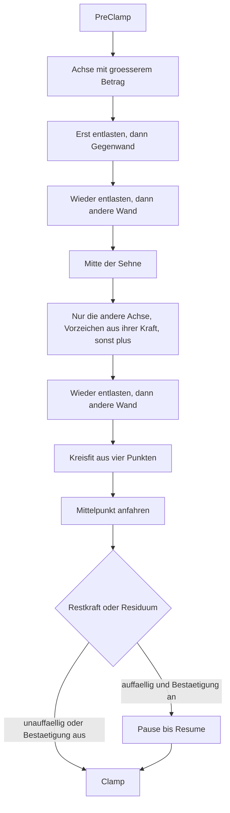

# Bohrungsmittelpunkt in PreClamp

## Bewertung

Die Methode passt. Der TCP des runden, kleineren Spreizerkopfs beschreibt bei Wandkontakt einen Kreis, der zur Bohrung konzentrisch ist. Sein Mittelpunkt ist der Bohrungsmittelpunkt. Vier Berührungen etwa in den Hauptrichtungen sind dafür eine gut bestimmte Messlage.

Zwei geometrische Punkte, die der Ablauf einhalten muss:

- Die erste Sehne (größeres `|F|`, bei Gleichstand X) wird halbiert. Diese Mitte hat bereits die richtige Koordinate des Zentrums auf dieser Achse, aber noch nicht die andere. Erst die zweite Sehne, gefahren von dieser Mitte, liegt nahe einem Durchmesser. Der anschließende Kreisfit aus allen vier Punkten mittelt das Rauschen und zeigt über das Residuum, ob die Punkte wirklich auf einem Kreis liegen.
- Gespeichert wird die Pose, wenn die Achskraft die Schwelle aus dem Inneren heraus erreicht und die Bahn steht. Dieselbe Schwelle, dieselbe Feingeschwindigkeit und dieselbe Anfahrrichtung auf allen vier Seiten. Die Gruppenlaufzeit des 100-ms-Fensters (etwa 0,1 mm bei 2 mm/s) verschiebt dann beide Wände gleich und fällt im Mittelpunkt heraus.

Kontakt ist `|F|` der gerade gefahrenen Achse gegen `xy_tolerance_N`, nicht der Kraftbetrag beider Achsen. Eine Wand, die innerhalb des Suchwegs nicht kommt, bricht ab. Eine Restkraft oder ein schlechter Kreis am Ende ist die Auffälligkeit, die der Bediener bestätigen kann.

Die bisherige Hysterese (0,05-mm-Schritte, höchstens ±2 mm) sucht diesen Mittelpunkt nicht. `xy_max_correction` von 2 mm reicht für das Spiel der Bohrung oft nicht. Sie wird in dieser Phase nicht mehr benutzt.

## Ablauf in der Phase

Neue Zustände in `[core/ProcedureController.cpp](core/ProcedureController.cpp)` `handlePreClamp`. Z bleibt stehen. Profil ist `v_fine_testpoints`. `setPreClampXyEnabled` bleibt aus, damit die alte Schrittregelung in `[core/Machine.cpp](core/Machine.cpp)` nicht mitfährt.

1. Jede Achse wird genau einmal durchlaufen, beide Wände, danach nicht wieder. Die erste Achse ist `argmax(|Fx|, |Fy|)`. Gleichstand oder keine Kraft über der Schwelle: X. Das Vorzeichen ist der Ausgleich dieser Kraft. Ohne solche Kraft zuerst die positive Richtung.
2. Die Fahrt läuft auf dieser festgelegten Achse zuerst, bis ihre Kraft unter `xy_tolerance_N` fällt, und in derselben Richtung weiter, bis die Schwelle an der Gegenwand wieder erreicht ist. Erst diese Pose wird gespeichert. Liegt die Kraft schon unter der Schwelle, geht es direkt zur Wand. Die Rückfahrt bleibt auf derselben Achse: an der eben berührten Wand ist die Kontaktkraft die größte, ihr Ausgleich führt von ihr weg durch den kraftfreien Bereich zur anderen Wand. Suchweg ab dem programmierten Punkt höchstens `xy_search_limit`. Darüber Abbruch.
3. Mitte der beiden Koordinaten anfahren, andere Achse unverändert.
4. An der Sehnenmitte wird die Achse nicht neu gewählt. Es bleibt die Achse, die noch nicht gefahren wurde. Entschieden wird nur noch das Vorzeichen, aus der Kraft dieser Achse an dieser Stelle: entgegen ihrem Vorzeichen, damit zuerst entlastet wird. Liegt auch hier keine größte Kraft vor, zuerst die positive Richtung. Danach beide Wände dieser Achse wie in Schritt 2.
5. Kreisfit der vier TCP-Punkte. Algebraische Anpassung `x² + y² + d·x + e·y + f = 0`, Mittelpunkt `(-d/2, -e/2)`. Liegen die Punkte fast auf einer Linie oder ist der Radius unsinnig, Abbruch.
6. Diesen Mittelpunkt anfahren. Nach Stillstand `|Fx|` und `|Fy|` gegen `xy_tolerance_N` und den größten Punktabstand zum Kreis prüfen.
7. Keine Auffälligkeit: `Clamp`. Auffälligkeit und Bestätigung ein: Prozess pausiert, die GUI zeigt die Kräfte und das Residuum, `CmdResume` geht nach `Clamp`, `CmdStop` bricht ab. Bestätigung aus: Hinweis nur protokollieren und automatisch nach `Clamp`.

`xy_correct_timeout_s` bleibt die Obergrenze der ganzen Suche. Der Default 2 s ist für vier Wandfahrten zu kurz und wird auf 30 s gesetzt, das ist die schon dokumentierte Obergrenze. `xy_correction_step` und `xy_max_attempts` bleiben im Konfigurationsframe unbenutzt, damit die bestehende Feldreihenfolge nicht verrutscht.

## Parameter und Protokoll

In `[core/MachineConfig.hpp](core/MachineConfig.hpp)` `Force` und im GUI-Katalog `[gui/server/config/parameterCatalog.js](gui/server/config/parameterCatalog.js)`:

- `xy_search_limit`, Millimeter, Default 5, höchstens `SafetyLimits::kMaxXyCorrection` (50 mm). Englisches Label. So weit darf die Suche vom angefahrenen Punkt abweichen.
- `preclamp_confirm`, Bool, Default ein. Schaltet die Pflicht zur Bestätigung bei Auffälligkeit aus.

Das verlängert `CmdSetMachineConfig`. GUI und Firmware müssen dieselbe Länge sprechen. Die Statusmeldung bleibt 41 Byte. Die Auffälligkeit geht in eine neue Telemetrie `MsgBoreCenter` (Mittelpunkt, vier Punkte, Residuum, Fx, Fy, ob eine Bestätigung aussteht). Die GUI-Prozedurseite zeigt dazu einen Dialog mit Weiter und Stopp. Weiter ist das bestehende `CmdResume`.

## Tests und Doku

- Reiner Kreisfit: vier Punkte auf einem bekannten Kreis, versetzter Start, Mittelpunkt innerhalb weniger hundertstel Millimeter. Fast kollineare Punkte werden abgelehnt.
- Prozedurtest mit injizierter Kraft, die außerhalb eines Kreises radial ansteigt. Start absichtlich neben der Mitte. Erwartet wird die Kreismitte, danach `Clamp`. Zweiter Fall: Restkraft über der Schwelle, mit Bestätigung Pause, ohne Bestätigung trotzdem `Clamp`. Dritter Fall: keine Wand im Suchweg, Abbruch.
- Die alten Hysterese-Tests in `tests/preclamp_tests.cpp` und `tests/forcecontrol_tests.cpp` werden auf die neue Phase angepasst. Der Watchdog bleibt auf der tarierten Kraft vor dem Tiefpass.
- `[docs/XY_Kraftregelung.md](docs/XY_Kraftregelung.md)` beschreibt die Sehnen, den Fit und die Laufzeit. `[docs/M18_Procedure.md](docs/M18_Procedure.md)` Punkt S10 wird der neue Ablauf.

Die `.hex` wird erst nach der Umsetzung neu gebaut. Flashen bleibt bei dir.