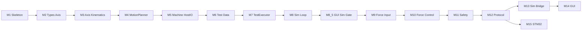

# Implementation Roadmap: Core + Simulation First (Revised)

Based on [docs/Project_Specification.md](docs/Project_Specification.md), [docs/Software_Architecture.md](docs/Software_Architecture.md), and [docs/Development_Rules.md](docs/Development_Rules.md).

Revised after documentation review: clear **Machine / MotionPlanner / TestExecutor** split, three state layers, thin **Host I/O**, force **control** (not only sensing), explicit **safety/E-Stop**, and **GUI vs Sim without STM32**.

**Scope rule for early milestones (M1–M11):** only `core/` and `simulation/`. No GUI, UART, or STM32-specific code until Core + Sim behavior is proven.

**Default stack:** CMake + C++17, Core as static library, Simulation as console executable that links Core.

## Core module responsibilities

| Module                       | Responsibility                                                                                                    |
| ---------------------------- | ----------------------------------------------------------------------------------------------------------------- |
| `Axis`                       | Single-axis kinematic state (position, velocity, acceleration, target); optional single-axis `tick`               |
| `MotionPlanner`              | Multi-axis motion toward a target pose each `tick`; owns `MotionState`                                            |
| `Machine`                    | Operational/safety state machine; STOP/PAUSE; applies `HostInputs`; exposes `HostOutputs`; commands MotionPlanner |
| `TestExecutor`               | Process sequencing over `TestProgram`; owns `ProcessState`; advances on motion AtTarget                           |
| `TestPoint` / `TestProgram`  | Fixed-capacity test data (no heap)                                                                                |
| `HostInputs` / `HostOutputs` | Thin I/O snapshot filled by Sim today, STM32 later (force, limits, E-Stop in; setpoints/pneumatic out)            |

No dedicated `ForceSensor` class — force is a field on `HostInputs`.

## State layers (do not mix)

- **MachineState** — Idle, Active, Paused, Stopped, Fault (operational/safety; no `Moving`)
- **MotionState** — Idle, Moving, AtTarget (owned by MotionPlanner)
- **ProcessState** — Idle, Running, Completed, Aborted (owned by TestExecutor)

TestExecutor advances when **MotionState == AtTarget**, not when Machine is Idle.

GUI path: M12 → M13 → M14 (formal protocol). **M8.5 / G3.5** is an early interactive gate using temporary TCP/JSON (pre-protocol), not a substitute for M12/M13.

STM32 path: M12 → M15 (parallel; does not block GUI).

---

## Milestone 1 — Build skeleton (compilable + runnable)

**Objective:** Smallest possible project that compiles and runs on the PC.

**Files/modules:**

- `CMakeLists.txt` (root)
- `core/CMakeLists.txt`
- `core/Types.hpp` (minimal placeholder)
- `core/core.cpp` (trivial `core_version()` returning `1`)
- `simulation/CMakeLists.txt`
- `simulation/main.cpp` (calls that function, prints result, exits 0)

**Dependencies:** CMake, C++ compiler. Simulation depends on Core only.

**Expected behavior:** Configure + build succeeds; simulation binary prints a fixed line and exits 0.

**How to test:** Configure, build, run executable; check exit code 0.

**Definition of done:**

- Out-of-source build works on the development PC
- Simulation links against Core
- No GUI / UART / STM32 code present

---

## Milestone 2 — Types and Axis state (no motion yet)

**Objective:** Shared types and an `Axis` that holds kinematic state and accepts a target, without integrating motion.

**Files/modules:**

- `core/Types.hpp` — `AxisId` (X/Y/Z); placeholders for state enums as needed later
- `core/Axis.hpp`, `core/Axis.cpp` — position, velocity, acceleration, target; getters/setters; `setTarget`; `isAtTarget`; `tick` no-op

**Dependencies:** Milestone 1.

**Expected behavior:** Construct `Axis`, set position/target, query state; `isAtTarget` true within tolerance.

**How to test:** Asserts in `simulation/main.cpp`: equal position/target → at target; different target → not at target.

**Definition of done:**

- Axis state readable/writable
- Tests pass
- No MotionPlanner, Machine, or Test* yet

---

## Milestone 3 — Single-axis kinematics

**Objective:** One axis moves toward its target with simple non-blocking kinematics (minimal profile; no detailed motor physics).

**Files/modules:**

- `core/Axis.hpp/.cpp` — implement `tick(float dt)`; update velocity/position; clamp at target; clear velocity when arrived

**Dependencies:** Milestone 2.

**Expected behavior:** Repeated `tick` with dt > 0 reaches target; dt = 0 does not advance.

**How to test:** Loop `tick(0.01f)` until `isAtTarget` within max steps; assert `dt=0` freeze.

**Definition of done:**

- Non-blocking single-axis motion works
- Deterministic enough for repeatable console tests
- No multi-axis orchestration yet

---

## Milestone 4 — MotionPlanner

**Objective:** Dedicated multi-axis motion planning as listed in the project specification (separate from Machine and TestExecutor).

**Files/modules:**

- `core/Types.hpp` — `MotionState` (Idle, Moving, AtTarget)
- `core/MotionPlanner.hpp/.cpp` — holds/uses three `Axis` (or references); `moveTo(x,y,z)`; `tick(dt)`; `stopMotion` / freeze; query `MotionState` and positions

**Dependencies:** Milestone 3.

**Expected behavior:**

- Idle → Moving on `moveTo`
- Moving → AtTarget when all axes at target
- `stopMotion` halts motion and leaves a defined MotionState
- `tick` never blocks

**How to test:** Command a pose; tick until AtTarget; mid-move stop; assert positions stable after stop.

**Definition of done:**

- Motion math and MotionState live in MotionPlanner only
- Machine does not embed axis integration
- No operational MachineState yet

---

## Milestone 5 — Machine + Host I/O + STOP/PAUSE

**Objective:** Operational/safety state machine; thin host I/O boundary so Sim and later STM32 feed Core the same way; STOP/PAUSE without blocking.

**Files/modules:**

- `core/Types.hpp` — `MachineState` (Idle, Active, Paused, Stopped, Fault) — **no Moving**
- `core/HostInputs.hpp` — force, limit flags, e_stop (fields may be unused until later milestones)
- `core/HostOutputs.hpp` — axis command/status mirrors as needed, pneumatic command/state placeholders
- `core/Machine.hpp/.cpp` — owns MotionPlanner; `setHostInputs`; `hostOutputs`; `moveTo` delegates to planner; `tick(dt)`; `pause` / `stop` / resume-or-reset; state getters

**Dependencies:** Milestone 4.

**Expected behavior:**

- Idle → Active when a move is commanded
- Active stays Active while MotionState is Moving; returns toward Idle when motion AtTarget and no higher-level process (executor comes later)
- Active → Paused on `pause` (planner frozen)
- Any non-terminal state → Stopped on `stop`
- `tick` never blocks
- Host fills `HostInputs` each cycle before `tick` (Sim does this)

**How to test:** Scripted move, partial tick, pause (stable pose), stop mid-move; verify MachineState vs MotionState separately.

**Definition of done:**

- Three state layers documented in code via distinct enums
- STOP/PAUSE interrupt without blocking
- Host I/O structs exist (even if some fields unused)
- No TestProgram yet

---

## Milestone 6 — TestPoint and TestProgram (data only)

**Objective:** Fixed-capacity list of XYZ test points without dynamic allocation.

**Files/modules:**

- `core/TestPoint.hpp` — POD: x, y, z
- `core/TestProgram.hpp` — fixed array + count; `add` / `clear` / `size` / `pointAt`

**Dependencies:** Milestone 2 types.

**Expected behavior:** Fill N points; reject overflow; read back in order.

**How to test:** Add/read asserts; over-capacity add fails cleanly.

**Definition of done:**

- No heap allocation
- No execution logic

---

## Milestone 7 — TestExecutor

**Objective:** Process-level sequencing of a `TestProgram` through Machine/MotionPlanner.

**Files/modules:**

- `core/Types.hpp` — `ProcessState` (Idle, Running, Completed, Aborted)
- `core/TestExecutor.hpp/.cpp` — references Machine + program; `start`; `tick`; advances on **MotionState AtTarget**; respects Machine Stopped/Paused

**Dependencies:** Milestones 5 and 6.

**Expected behavior:**

- `start` commands first point via Machine
- On AtTarget, command next point
- After last point → Completed
- Machine stop → ProcessState Aborted

**How to test:** 2–3 point program to Completed; mid-run STOP → Aborted, not Completed.

**Definition of done:**

- ProcessState separate from MachineState/MotionState
- Non-blocking; STOP aborts cleanly

---

## Milestone 8 — Simulation host loop (end-to-end Core on PC)

**Objective:** Simulation as PC host: fixed dt, fills HostInputs, calls tick, prints Machine/Motion/Process/axis state, runs one demo program.

**Files/modules:**

- `simulation/main.cpp` — wire Core objects, hardcoded demo program, loop until Completed/Aborted/timeout

**Dependencies:** Milestone 7.

**Expected behavior:** Console shows progression through demo points; ends Completed (or Aborted if stop injected).

**How to test:** Run sim; assert final positions match last point within tolerance within max ticks.

**Definition of done:**

- Full Core exercise on PC
- Same Core entrypoints intended for STM32 later
- Still no GUI / UART / STM32

---

## Milestone 8.5 — Interactive Sim Host + G3.5 GUI gate (pre-protocol)

**Objective:** Long-running `simulation_interactive` drives Core `Machine` over temporary localhost TCP/JSON so G3 HMI (`MACHINE_CLIENT=sim`) can MoveTo/Pause/Resume/Stop and display TCP in Three.js. Motion stays entirely in Core.

**Files/modules:**

- `simulation_interactive/` — TCP host, `Machine::tick` only (no TestExecutor)
- `gui/server/sim/simMachineClient.js` — command forward + status cache (no JS kinematics)
- G3 HMI Three.js viewport (npm `three`, Z-up 1:1)

**Dependencies:** M5 Machine + M8 demo kept as regression; G3 HTTP/WS UI.

**Expected behavior:** Independent host process on port 8765; GUI sim client; X→Y→Z and combined XYZ moves visible; Pause/Resume/Stop match Machine semantics.

**Definition of done:**

- No Core M1–M7 API changes
- No Force/Safety/HAL/UART/`communication/`
- TCP/JSON documented as **temporary pre-protocol** (not M12/M13)
- M8 `simulation.exe` unchanged behavior
- Mock client still works offline

---

## Milestone 9 — 3D force input stub

**Objective:** 3D force vector on `HostInputs` (`ForceVector` with `fx`, `fy`, `fz` in Newton [N]); Sim provides a deterministic fake force for all three axes. Machine stores the snapshot only — no force evaluation or control. No `ForceSensor` class.

**Files/modules:**

- `core/HostInputs.hpp` — `ForceVector force` replaces scalar `force`
- `core/Machine.hpp/.cpp` — `hostInputs()` getter; `setHostInputs()` unchanged (snapshot store)
- `simulation/main.cpp` — deterministic 3D stub each tick; print Fx/Fy/Fz
- `simulation_interactive/main.cpp` — same stub internally; TCP/JSON status unchanged (no force fields)
- `tests/hostinputs_tests.cpp`, `tests/machine_tests.cpp`

**Dependencies:** Milestone 8.

**Expected behavior:** Force visible in M8 console output; Core reads `machine.hostInputs().force.{fx,fy,fz}`; MotionPlanner/Axis unchanged; no closed-loop force control.

**How to test:** `hostinputs_tests`, machine roundtrip test; move axes — stub force follows `fx=kx*x`, `fy=ky*y`, `fz=kz*z`; setting force does not change pose or motion state.

**Definition of done:**

- 3D sensing path only (M10 takes force control)
- No detailed physics; no GUI/protocol changes

---

## Milestone 10 — Force control + XY correction

**Objective:** Cover Spec “force control” and Architecture “force-dependent XY correction” in simplified form (no physics engine).

**Files/modules:**

- Core logic under Machine and/or MotionPlanner (keep classes single-purpose: e.g. Machine decides corrections/commands; MotionPlanner executes poses)
- Optional force-related fields on `TestPoint` if required for the chosen simple control law
- Simulation continues to supply force via HostInputs

**Dependencies:** Milestone 9.

**Expected behavior:**

- Defined simple force-control behavior during Z-related motion (e.g. stop/hold when force threshold reached — exact law kept minimal and documented in milestone notes when implementing)
- Simplified force-dependent XY correction applied when force condition requires it

**How to test:** Scripted Z move with stub force ramp; assert stop/hold/correction triggers; XY correction only when force condition met.

**Definition of done:**

- Force control is real Core behavior, not display-only
- XY correction present in simplified form
- Still no HAL / GUI / UART

---

## Milestone 11 — Safety: limits, E-Stop, pneumatic stubs

**Objective:** Architecture “later” plant I/O: limit switches, emergency stop handling (Spec), pneumatic cylinder — stubs only.

**Files/modules:**

- `HostInputs` — limit flags, `e_stop`
- `HostOutputs` — pneumatic command/state
- `Machine` — E-Stop → immediate safe stop / Fault or Stopped per chosen rule; limit violation → Fault/Stop; pneumatic command path
- Simulation — derive limits from positions; set e_stop in a test scenario; toggle pneumatic

**Dependencies:** Milestone 10 (or after M8 if force control deferred — prefer after force control so safety interacts with active motion/force).

**Expected behavior:**

- Software STOP (command) remains available
- E-Stop input forces immediate safe halt even if a test is running
- Limit hit → Fault/Stop
- Pneumatic state readable after command

**How to test:** Inject e_stop mid-move; drive past soft limit; command pneumatic; assert states.

**Definition of done:**

- Documented distinction: protocol/GUI STOP vs E-Stop input
- Still no HAL

---

## Milestone 12 — Communication protocol (host-agnostic)

**Objective:** Serializable command/status messages for Pi ↔ controller without UART drivers.

**Files/modules:**

- `communication/` — message IDs; pack/unpack start/stop/pause, load/run program summaries, status, positions, force, fault flags
- PC round-trip harness under `simulation/` or `tests/`

**Dependencies:** Stable Machine/TestExecutor API (M7–M8+).

**Expected behavior:** Encode/decode round-trip for each message type.

**How to test:** Round-trip vectors.

**Definition of done:**

- Protocol usable by Sim bridge, GUI, and STM32
- Core control logic remains inside Core; protocol is boundary only

---

## Milestone 13 — Sim protocol bridge (no STM32)

**Objective:** PC simulation speaks the protocol so Node.js GUI can connect without hardware.

**Files/modules:**

- `simulation/` bridge (e.g. TCP/stdio framing of protocol messages — transport chosen at implementation time, kept simple)
- Maps protocol commands ↔ Machine/TestExecutor; status from Core + Host I/O

**Dependencies:** Milestone 12.

**Expected behavior:** External client can start/stop/pause and read status from running Sim+Core.

**How to test:** Small script or netcat-style client sending packed messages; assert state changes.

**Definition of done:**

- GUI path unblocked without STM32
- No STM32 code required

---

## Milestone 14 — Node.js GUI against Sim

**Objective:** Web GUI loads/validates JSON test programs, sends protocol commands, displays status — against Sim bridge.

**Files/modules:**

- `gui/` — Node server + frontend; JSON validation; protocol client targeting Sim bridge

**Dependencies:** Milestone 13 only (not STM32).

**Expected behavior:** Operator loads program, starts/stops/pauses, sees positions/force/state from Sim.

**How to test:** Manual UI tests vs Sim; invalid JSON rejected.

**Definition of done:**

- Pi/GUI remains non-real-time
- Works fully without STM32 hardware

---

## Milestone 15 — STM32 firmware host (parallel path)

**Objective:** Same Core on STM32F446RE; HAL only outside Core; UART (or chosen link) uses protocol from M12.

**Files/modules:**

- `firmware/` / `stm32/` — timer tick → Core `tick`; map HAL sensors/actuators ↔ HostInputs/HostOutputs; protocol over UART

**Dependencies:** Milestone 12 + Core behavior through M11.

**Expected behavior:** Same state progression as Sim for a demo program (step outputs may start stubbed).

**How to test:** Compare UART status stream to known Sim trace; E-Stop and STOP on target.

**Definition of done:**

- Core remains platform-independent (no HAL inside Core classes)
- STM32 remains authority for real-time motion/safety when hardware is used
- Architectural shape unchanged from Sim host pattern (tick + Host I/O + protocol)

---

## Working rules across all milestones

- One milestone at a time; compile and test after each (Development Rules §14)
- Do not implement unrequested features inside a milestone
- Keep Core free of STM32 HAL, OS, and Node APIs
- Prefer fixed-size data (no dynamic allocation in Core paths meant for STM32)
- Non-blocking state machines; STOP always possible; E-Stop input handled when introduced
- Simulation approximates behavior, not detailed motor physics
- No unnecessary design patterns; MotionPlanner is one small class, not a framework

## Immediate next step after approval

Implement **only Milestone 1** (CMake + trivial Core + runnable `simulation/main`).