# Implementation Roadmap: Core + Simulation First (Revised)

Based on [docs/Project_Specification.md](docs/Project_Specification.md), [docs/Software_Architecture.md](docs/Software_Architecture.md), and [docs/Development_Rules.md](docs/Development_Rules.md).

Revised after documentation review: clear **Machine / MotionPlanner / TestExecutor** split, three state layers, thin **Host I/O**, force **control** (not only sensing), explicit **safety/E-Stop**, and **GUI vs Sim without STM32**.

**Scope rule for early milestones (M1–M11):** only `core/` and `simulation/`. No GUI, UART, or STM32-specific code until Core + Sim behavior is proven.

**Default stack:** CMake + C++17, Core as static library, Simulation as console executable that links Core.

## Core module responsibilities

| Module                       | Responsibility                                                                                                    |
| ---------------------------- | ----------------------------------------------------------------------------------------------------------------- |
| `Axis`                       | Single-axis kinematic state (position, velocity, acceleration, target); optional single-axis `tick`               |
| `MotionPlanner`              | Multi-axis motion toward a target pose each `tick`; owns `MotionState`                                            |
| `Machine`                    | Operational/safety state machine; STOP/PAUSE; applies `HostInputs`; exposes `HostOutputs`; commands MotionPlanner |
| `TestExecutor`               | Facade over `ProcedureController`; owns `ProcessState`                                                            |
| `ProcedureController`        | Automated test/aging sequence including ProbeApproach / ProbeCalibration                                          |
| `ProbeCalibration` / `ProbeSearch` | Non-blocking touch-probe protocol (Z + four XY contacts, tool_offset replace)                              |
| `TestPoint` / `TestProgram`  | Fixed-capacity test data (no heap)                                                                                |
| `HostInputs` / `HostOutputs` | Thin I/O snapshot filled by Sim today, STM32 later (force, limits, E-Stop, probe trigger in; setpoints/pneumatic out) |

No dedicated `ForceSensor` class — force is a field on `HostInputs`.

## State layers (do not mix)

- **MachineState** — Idle, Active, Paused, Stopped, Fault, Homing (operational/safety; no `Moving`)
- **MotionState** — Idle, Moving, AtTarget (owned by MotionPlanner)
- **ProcessState** — Idle, Running, Completed, Aborted (owned by TestExecutor)
- **HomingState** — None, HomingZ, HomingX, HomingY, Homed, HomingError (owned by Machine; M16)

TestExecutor advances when **MotionState == AtTarget**, not when Machine is Idle.

```mermaid
flowchart LR
  M1[M1 Skeleton] --> M2[M2 Types Axis]
  M2 --> M3[M3 Axis Kinematics]
  M3 --> M4[M4 MotionPlanner]
  M4 --> M5[M5 Machine HostIO]
  M5 --> M6[M6 Test Data]
  M6 --> M7[M7 TestExecutor]
  M7 --> M8[M8 Sim Loop]
  M8 --> M85[M8_5 GUI Sim Gate]
  M85 --> M9[M9 Force Input]
  M9 --> M10[M10 Force Control]
  M10 --> M11[M11 Safety]
  M11 --> M12[M12 Protocol]
  M12 --> M13[M13 Sim Bridge]
  M13 --> M14[M14 GUI]
  M14 --> M141[M14_1 Dev Runtime]
  M141 --> M142[M14_2 Architecture]
  M142 --> M15[M15 Simulation UI]
  M15 --> M16[M16 Limits Homing]
  M12 --> M16
  M11 --> M16
  M16 --> M17[M17 Procedure]
  M12 --> M17
  M17 --> M18[M18 Safety]
  M18 --> M190[M19.0 Probe Calib]
  M190 --> M19x[M19.x STM32]
  M12 --> M19x
```

GUI path: M12 → M13 → M14 (formal protocol). **M14.1** hardens local dev start/stop; **M14.2** verifies and documents GUI/Core/Simulation separation with independent runtime lifecycles. **M8.5 / G3.5** is an early interactive gate using temporary TCP/JSON (pre-protocol), not a substitute for M12/M13.

**M15** adds the standalone simulation UI and the virtual outside world (sensors in the C++ host). **M16** refines Core limit reaction (directional soft block, no global Fault), adds homing Z+→X+→Y+, extends M12 StatusReport, and gives SimPlant all six limit switches.

**M17** is the automated test/aging procedure (Core + M12 + GUI parameters). **M18** is safety hardening (Safe-Z, watchdogs, runtime lock). **M19.0** (inserted) ports the historical ABB touch-probe protocol onto the 3-axis Core; no STM32 HAL. STM32 firmware hosting is **M19.x** (later; previously numbered M19, and before that M18/M17). Parallel to the GUI path; does not replace Core.

**Hardwarefreigabe bleibt NEIN** until a dedicated hardware-validation milestone after STM32 hosting.

---

## Milestone 1 — Build skeleton (compilable + runnable)

**Objective:** Smallest possible project that compiles and runs on the PC.

**Files/modules:**

- `CMakeLists.txt` (root)
- `core/CMakeLists.txt`
- `core/Types.hpp` (minimal placeholder)
- `core/core.cpp` (trivial `core_version()` returning `1`)
- `simulation/CMakeLists.txt`
- `simulation/main.cpp` (calls that function, prints result, exits 0)

**Dependencies:** CMake, C++ compiler. Simulation depends on Core only.

**Expected behavior:** Configure + build succeeds; simulation binary prints a fixed line and exits 0.

**How to test:** Configure, build, run executable; check exit code 0.

**Definition of done:**

- Out-of-source build works on the development PC
- Simulation links against Core
- No GUI / UART / STM32 code present

---

## Milestone 2 — Types and Axis state (no motion yet)

**Objective:** Shared types and an `Axis` that holds kinematic state and accepts a target, without integrating motion.

**Files/modules:**

- `core/Types.hpp` — `AxisId` (X/Y/Z); placeholders for state enums as needed later
- `core/Axis.hpp`, `core/Axis.cpp` — position, velocity, acceleration, target; getters/setters; `setTarget`; `isAtTarget`; `tick` no-op

**Dependencies:** Milestone 1.

**Expected behavior:** Construct `Axis`, set position/target, query state; `isAtTarget` true within tolerance.

**How to test:** Asserts in `simulation/main.cpp`: equal position/target → at target; different target → not at target.

**Definition of done:**

- Axis state readable/writable
- Tests pass
- No MotionPlanner, Machine, or Test* yet

---

## Milestone 3 — Single-axis kinematics

**Objective:** One axis moves toward its target with simple non-blocking kinematics (minimal profile; no detailed motor physics).

**Files/modules:**

- `core/Axis.hpp/.cpp` — implement `tick(float dt)`; update velocity/position; clamp at target; clear velocity when arrived

**Dependencies:** Milestone 2.

**Expected behavior:** Repeated `tick` with dt > 0 reaches target; dt = 0 does not advance.

**How to test:** Loop `tick(0.01f)` until `isAtTarget` within max steps; assert `dt=0` freeze.

**Definition of done:**

- Non-blocking single-axis motion works
- Deterministic enough for repeatable console tests
- No multi-axis orchestration yet

---

## Milestone 4 — MotionPlanner

**Objective:** Dedicated multi-axis motion planning as listed in the project specification (separate from Machine and TestExecutor).

**Files/modules:**

- `core/Types.hpp` — `MotionState` (Idle, Moving, AtTarget)
- `core/MotionPlanner.hpp/.cpp` — holds/uses three `Axis` (or references); `moveTo(x,y,z)`; `tick(dt)`; `stopMotion` / freeze; query `MotionState` and positions

**Dependencies:** Milestone 3.

**Expected behavior:**

- Idle → Moving on `moveTo`
- Moving → AtTarget when all axes at target
- `stopMotion` halts motion and leaves a defined MotionState
- `tick` never blocks

**How to test:** Command a pose; tick until AtTarget; mid-move stop; assert positions stable after stop.

**Definition of done:**

- Motion math and MotionState live in MotionPlanner only
- Machine does not embed axis integration
- No operational MachineState yet

---

## Milestone 5 — Machine + Host I/O + STOP/PAUSE

**Objective:** Operational/safety state machine; thin host I/O boundary so Sim and later STM32 feed Core the same way; STOP/PAUSE without blocking.

**Files/modules:**

- `core/Types.hpp` — `MachineState` (Idle, Active, Paused, Stopped, Fault) — **no Moving**
- `core/HostInputs.hpp` — force, limit flags, e_stop (fields may be unused until later milestones)
- `core/HostOutputs.hpp` — axis command/status mirrors as needed, pneumatic command/state placeholders
- `core/Machine.hpp/.cpp` — owns MotionPlanner; `setHostInputs`; `hostOutputs`; `moveTo` delegates to planner; `tick(dt)`; `pause` / `stop` / resume-or-reset; state getters

**Dependencies:** Milestone 4.

**Expected behavior:**

- Idle → Active when a move is commanded
- Active stays Active while MotionState is Moving; returns toward Idle when motion AtTarget and no higher-level process (executor comes later)
- Active → Paused on `pause` (planner frozen)
- Any non-terminal state → Stopped on `stop`
- `tick` never blocks
- Host fills `HostInputs` each cycle before `tick` (Sim does this)

**How to test:** Scripted move, partial tick, pause (stable pose), stop mid-move; verify MachineState vs MotionState separately.

**Definition of done:**

- Three state layers documented in code via distinct enums
- STOP/PAUSE interrupt without blocking
- Host I/O structs exist (even if some fields unused)
- No TestProgram yet

---

## Milestone 6 — TestPoint and TestProgram (data only)

**Objective:** Fixed-capacity list of XYZ test points without dynamic allocation.

**Files/modules:**

- `core/TestPoint.hpp` — POD: x, y, z
- `core/TestProgram.hpp` — fixed array + count; `add` / `clear` / `size` / `pointAt`

**Dependencies:** Milestone 2 types.

**Expected behavior:** Fill N points; reject overflow; read back in order.

**How to test:** Add/read asserts; over-capacity add fails cleanly.

**Definition of done:**

- No heap allocation
- No execution logic

---

## Milestone 7 — TestExecutor

**Objective:** Process-level sequencing of a `TestProgram` through Machine/MotionPlanner.

**Files/modules:**

- `core/Types.hpp` — `ProcessState` (Idle, Running, Completed, Aborted)
- `core/TestExecutor.hpp/.cpp` — references Machine + program; `start`; `tick`; advances on **MotionState AtTarget**; respects Machine Stopped/Paused

**Dependencies:** Milestones 5 and 6.

**Expected behavior:**

- `start` commands first point via Machine
- On AtTarget, command next point
- After last point → Completed
- Machine stop → ProcessState Aborted

**How to test:** 2–3 point program to Completed; mid-run STOP → Aborted, not Completed.

**Definition of done:**

- ProcessState separate from MachineState/MotionState
- Non-blocking; STOP aborts cleanly

---

## Milestone 8 — Simulation host loop (end-to-end Core on PC)

**Objective:** Simulation as PC host: fixed dt, fills HostInputs, calls tick, prints Machine/Motion/Process/axis state, runs one demo program.

**Files/modules:**

- `simulation/main.cpp` — wire Core objects, hardcoded demo program, loop until Completed/Aborted/timeout

**Dependencies:** Milestone 7.

**Expected behavior:** Console shows progression through demo points; ends Completed (or Aborted if stop injected).

**How to test:** Run sim; assert final positions match last point within tolerance within max ticks.

**Definition of done:**

- Full Core exercise on PC
- Same Core entrypoints intended for STM32 later
- Still no GUI / UART / STM32

---

## Milestone 8.5 — Interactive Sim Host + G3.5 GUI gate (pre-protocol)

**Objective:** Long-running `simulation_interactive` drives Core `Machine` over temporary localhost TCP/JSON so G3 HMI (`MACHINE_CLIENT=sim`) can MoveTo/Pause/Resume/Stop and display TCP in Three.js. Motion stays entirely in Core.

**Files/modules:**

- `simulation_interactive/` — TCP host, `Machine::tick` only (no TestExecutor)
- `gui/server/sim/simMachineClient.js` — command forward + status cache (no JS kinematics)
- G3 HMI Three.js viewport (npm `three`, Z-up 1:1)

**Dependencies:** M5 Machine + M8 demo kept as regression; G3 HTTP/WS UI.

**Expected behavior:** Independent host process on port 8765; GUI sim client; X→Y→Z and combined XYZ moves visible; Pause/Resume/Stop match Machine semantics.

**Definition of done:**

- No Core M1–M7 API changes
- No Force/Safety/HAL/UART/`communication/`
- TCP/JSON documented as **temporary pre-protocol** (not M12/M13)
- M8 `simulation.exe` unchanged behavior
- Mock client still works offline

---

## Milestone 9 — 3D force input stub

**Objective:** 3D force vector on `HostInputs` (`ForceVector` with `fx`, `fy`, `fz` in Newton [N]); Sim provides a deterministic fake force for all three axes. Machine stores the snapshot only — no force evaluation or control. No `ForceSensor` class.

**Files/modules:**

- `core/HostInputs.hpp` — `ForceVector force` replaces scalar `force`
- `core/Machine.hpp/.cpp` — `hostInputs()` getter; `setHostInputs()` unchanged (snapshot store)
- `simulation/main.cpp` — deterministic 3D stub each tick; print Fx/Fy/Fz
- `simulation_interactive/main.cpp` — same stub internally; TCP/JSON status unchanged (no force fields)
- `tests/hostinputs_tests.cpp`, `tests/machine_tests.cpp`

**Dependencies:** Milestone 8.

**Expected behavior:** Force visible in M8 console output; Core reads `machine.hostInputs().force.{fx,fy,fz}`; MotionPlanner/Axis unchanged; no closed-loop force control.

**How to test:** `hostinputs_tests`, machine roundtrip test; move axes — stub force follows `fx=kx*x`, `fy=ky*y`, `fz=kz*z`; setting force does not change pose or motion state.

**Definition of done:**

- 3D sensing path only (M10 takes force control)
- No detailed physics; no GUI/protocol changes

---

## Milestone 10 — Force control + XY correction

**Objective:** Cover Spec “force control” and Architecture “force-dependent XY correction” in simplified form (no physics engine).

**Files/modules:**

- Core logic under Machine and/or MotionPlanner (keep classes single-purpose: e.g. Machine decides corrections/commands; MotionPlanner executes poses)
- Optional force-related fields on `TestPoint` if required for the chosen simple control law
- Simulation continues to supply force via HostInputs

**Dependencies:** Milestone 9.

**Expected behavior:**

- Defined simple force-control behavior during Z-related motion (e.g. stop/hold when force threshold reached — exact law kept minimal and documented in milestone notes when implementing)
- Simplified force-dependent XY correction applied when force condition requires it

**How to test:** Scripted Z move with stub force ramp; assert stop/hold/correction triggers; XY correction only when force condition met.

**Definition of done:**

- Force control is real Core behavior, not display-only
- XY correction present in simplified form
- Still no HAL / GUI / UART

---

## Milestone 11 — Safety: limits, E-Stop, pneumatic stubs

**Objective:** Architecture “later” plant I/O: limit switches, emergency stop handling (Spec), pneumatic cylinder — stubs only.

**Files/modules:**

- `HostInputs` — limit flags, `e_stop`
- `HostOutputs` — pneumatic command/state
- `Machine` — E-Stop → immediate safe stop / Fault or Stopped per chosen rule; limit violation → Fault/Stop; pneumatic command path
- Simulation — derive limits from positions; set e_stop in a test scenario; toggle pneumatic

**Dependencies:** Milestone 10 (or after M8 if force control deferred — prefer after force control so safety interacts with active motion/force).

**Expected behavior:**

- Software STOP (command) remains available
- E-Stop input forces immediate safe halt even if a test is running
- Limit hit → Fault/Stop (M11 baseline; **M16** replaces this with per-direction soft blocking, no global Fault)
- Pneumatic state readable after command

**How to test:** Inject e_stop mid-move; drive past soft limit; command pneumatic; assert states.

**Definition of done:**

- Documented distinction: protocol/GUI STOP vs E-Stop input
- Still no HAL

---

## Milestone 12 — Communication protocol (host-agnostic)

**Objective:** Serializable command/status messages for Pi ↔ controller without UART drivers.

**Files/modules:**

- `communication/` — message IDs; pack/unpack start/stop/pause, load/run program summaries, status, positions, force, fault flags
- PC round-trip harness under `simulation/` or `tests/`

**Dependencies:** Stable Machine/TestExecutor API (M7–M8+).

**Expected behavior:** Encode/decode round-trip for each message type.

**How to test:** Round-trip vectors.

**Definition of done:**

- Protocol usable by Sim bridge, GUI, and STM32
- Core control logic remains inside Core; protocol is boundary only

---

## Milestone 13 — Sim protocol bridge (no STM32)

**Objective:** PC simulation speaks the protocol so Node.js GUI can connect without hardware.

**Files/modules:**

- `simulation/` bridge (e.g. TCP/stdio framing of protocol messages — transport chosen at implementation time, kept simple)
- Maps protocol commands ↔ Machine/TestExecutor; status from Core + Host I/O

**Dependencies:** Milestone 12.

**Expected behavior:** External client can start/stop/pause and read status from running Sim+Core.

**How to test:** Small script or netcat-style client sending packed messages; assert state changes.

**Definition of done:**

- GUI path unblocked without STM32
- No STM32 code required

---

## Milestone 14 — Node.js GUI against Sim

**Objective:** Web GUI loads/validates JSON test programs, sends protocol commands, displays status — against Sim bridge.

**Files/modules:**

- `gui/` — Node server + frontend; JSON validation; protocol client targeting Sim bridge

**Dependencies:** Milestone 13 only (not STM32).

**Expected behavior:** Operator loads program, starts/stops/pauses, sees positions/force/state from Sim.

**How to test:** Manual UI tests vs Sim; invalid JSON rejected.

**Definition of done:**

- Pi/GUI remains non-real-time
- Works fully without STM32 hardware

---

## Milestone 14.1 — Development runtime lifecycle

**Objective:** Reproducible local dev start/stop without orphan `simulation_protocol` or GUI processes; no accidental killing of unrelated Node processes.

**Scope (dev infrastructure only):** `gui/scripts/`, `gui/package.json`, `gui/README.md`, `.gitignore` for runtime PID artifacts. No changes to Core, communication, bridge, or ProtocolMachineClient logic.

**Files/modules:**

- `gui/scripts/dev-common.ps1` — shared helpers (port checks, process ownership, repo-relative paths)
- `gui/scripts/dev-start-all.ps1`, `dev-stop-all.ps1` — convenience: simulation then GUI
- Aliases: `dev-start.ps1` → start-all, `dev-stop.ps1` → stop-all
- `gui/.dev-runtime/` — PID files (gitignored); validated before kill
- `gui/server/index.js` — clearer `EADDRINUSE` message (suggest `npm run dev:stop`)

**Dependencies:** Milestone 14 (protocol GUI path in use).

**Expected behavior:**

- `npm run dev:start` / `dev:stop` start and stop **project** GUI (:3000) and `simulation_protocol` (:8766) only
- Idempotent stop; port readiness polling (not fixed sleep only)
- Re-start after forgotten processes cleans up safely
- Ctrl+C on start script cleans up owned PIDs; explicit `dev:stop` documented as fallback

**Safety rules:**

- Never `Stop-Process -Name node` globally
- Kill only when CommandLine / WorkingDirectory / port + PID file confirm repo ownership
- If ownership unclear → warn, do not kill

**How to test:** Clean start/stop; double start; orphan recovery; offline/reconnect smoke unchanged; `test:protocol`, `smoke:g14`, CTest 14/14.

**Definition of done:**

- Dev environment start/stop is reproducible
- M14 protocol behavior unchanged
- No unrelated process termination

---

## Milestone 14.2 — Architecture verification & runtime separation

**Objective:** Document and prove that **GUI = HMI**, **Core = controller**, **simulation host = outer world/runtime** — not a second controller. Decouple GUI and simulation **development lifecycles** so either can run without the other.

**Scope:** Architecture documentation, dev-script separation, automated proofs. No STM32 firmware, no large Core refactor, no new M12 commands.

**Files/modules:**

- `docs/M14_2_Architecture.md` — components, responsibilities, command/status flows, MOVE_TO sequences, STM32 outlook, honest controller vs simulation classification
- `gui/scripts/dev-start-gui.ps1`, `dev-stop-gui.ps1` — GUI only
- `gui/scripts/dev-start-simulation.ps1`, `dev-stop-simulation.ps1` — controller host only
- `gui/scripts/m14_2_architecture_proof.js` — `npm run proof:architecture` (GUI without controller, controller without GUI, combined, disconnect/reconnect, independent stop)
- `gui/README.md` — independent runtime commands

**Dependencies:** Milestones 14 and 14.1.

**Expected behavior:**

- GUI with `MACHINE_CLIENT=protocol` runs offline; MOVE_TO rejected; pose frozen
- `simulation_protocol` alone accepts M12 MOVE_TO; status changes without browser/GUI
- `dev:stop-simulation` does **not** stop GUI; `dev:stop-gui` does **not** stop simulation
- Three.js pose updates only from received status (`setTcpPose`); no local kinematics in protocol path

**Central verification question (documented answer):**

- Command authority: Core (`Machine`, `TestExecutor`) via bridge mapping
- GUI/ProtocolClient: transport + display only
- Nuance documented: simplified axis integration currently in Core (`MotionPlanner`/`Axis`); virtual sensors in `SimHostInputProvider`

**How to test:** `npm run proof:architecture`, `proof:offline`, `test:protocol`, `smoke:g14`, CTest 14/14; manual independent start/stop of GUI vs simulation.

**Definition of done:**

- Architecture documented in `docs/M14_2_Architecture.md`
- GUI and controller host independently start/stop
- Automated separation proofs pass
- Existing M13/M14 functionality preserved
- No unnecessary large refactor

---

## Milestone 15 — Simulation UI & virtual outside world

**Objective:** Standalone simulation UI with a 3D gantry that visualizes the **Core-computed** pose, plus a virtual outside world in the C++ host that feeds sensors into `HostInputs`. No controller logic in the UI.

**Scope:** New `/simulation` page, `simulation_plant` module, separate plant channel. No M12 extension, no Core refactor, no JS kinematics, no force simulation.

**Files/modules:**

- `simulation_plant/SimPlant.*` — virtual sensors: position-based max limit switches, `probeTriggered` pulse, E-Stop input, force always zero
- `simulation_plant/PlantCommandCodec.*` — JSON commands for the plant channel
- `simulation_protocol/PlantChannelServer.*` — TCP/JSON line channel on port 8767 (simulation only)
- `core/HostInputs.hpp` — new `probeTriggered` field
- `gui/public/simulation.html`, `css/simulation.css`, `js/sim/*` — UI shell, plant API, `gantryView` (hierarchical Three.js gantry)
- `gui/server/simulation/plantClient.js`, `/api/simulation/*` in `gui/server/index.js` — Node proxy to the plant channel

**Dependencies:** Milestones 12–14.2.

**Expected behavior:**

- Pose comes only from `StatusReport` → WebSocket → `gantryView.setPose()`
- Reaching a configured max limit sets the sensor HIGH; the **Core** decides the reaction (M15: latched `Fault`; superseded in **M16** by directional soft blocking)
- Probe button produces a short `probeTriggered` pulse; Core only accepts the signal
- `fx = fy = fz = 0`; Core force-control code untouched
- Simulation host stopped: both UIs stay open, pose frozen, commands rejected, plant requests report a connection error

**How to test:** CTest (`simplant_tests`, `plantchannel_tests`), `npm run smoke:m15`, existing `test:protocol`, `smoke:g14`, `proof:offline`, `proof:architecture`, G8/G9 tests; manual browser check of X/Y/Z hierarchy.

**Definition of done:**

- Controller logic stays in Core; simulation only produces sensor values and visualizes pose
- M12 frame structure, message IDs, and `simulation_interactive` unchanged
- Independent GUI/simulation lifecycles from M14.2 preserved
- Documented in `docs/M15_Simulation_UI.md`

---

## Milestone 16 — Soft limits, homing, fault reset (Core + Sim + M12)

**Objective:** End stops must not freeze the whole machine. An active limit blocks **only** motion into that direction on that axis. Motion away from the stop and motion of other axes stay possible. Homing uses an explicit sequence Z+ → X+ → Y+. The M12 status/command surface is defined and tested **before** Maschinen-GUI (Agent 2) consumes it.

**Scope:** Core limit/homing logic, M12 StatusReport 35→38 bytes + `CmdHome`, SimPlant six limits, Simulations-UI plant controls. No STM32. No Maschinen-GUI assumptions about byte offsets or enum values.

**Files/modules:**

- `core/Types.hpp`, `core/Machine.*` — `HomingState`, `MachineState::Homing`, `applyEffectiveTargets()`, `home()`, `blockedDirections()`, `limitWarningActive()`
- `communication/` — `CmdHome = 0x15`, StatusReport wire size 38 (`homing_state`, `blocked_directions`, `flags`)
- `simulation_bridge/StatusSnapshot.cpp`, `CommandDispatcher.cpp` — status mapping; `CmdHome` → `machine.home()`; reject `CmdMoveTo` while Homing
- `simulation_plant/SimPlant.*`, `PlantCommandCodec.*` — six trip points (`xMin`/`xMax`/`yMin`/`yMax`/`zMin`/`zMax`)
- `gui/server/protocol/` — JS codec/types/client mirror (`clearFault`, `home`, 38-byte status)
- `gui/public/simulation.html`, `js/sim/*`, `css/simulation.css` — six limit inputs, E-Stop, homing/warning/homed readouts, trajectory/limit toggles
- `docs/M16_Agent2_Interface.md` — protocol contract for Agent 2

**Dependencies:** Milestones 11, 12, and 15.

**Expected behavior:**

- Blocking is recomputed each tick from current limit flags + current stored target. Planner targets may be clamped; **`stored_target_*` is never overwritten**, so a later command away from the stop still works.
- `Fault` remains reserved for E-Stop and Fz safety. Limits set `limitWarning` / `blockedDirections` only.
- Homing phases: Z+ → X+ → Y+ toward the configured SimPlant limits. Reaching the phase limit **completes** that phase (success); the axis is not commanded further into the stop; the next phase starts immediately.
- `STOP` during homing → `HomingError` + `Stopped`. E-Stop during homing → `Fault`.
- `clearFault` / `CmdClearFault` (0x14) is exposed on the Node command API; Core still rejects reset while E-Stop or |Fz| ≥ threshold is active.
- Agent 2 uses only the JS helpers in `gui/server/protocol/` (`statusReportToGuiStatus`, command IDs). No GUI-side guesses of offsets or enum integers.

**How to test:** CTest (`limit_blocking_tests`, `homing_tests`, `safety_tests`, `protocol_tests`, `simplant_tests`, `plantchannel_tests`, `bridge_*`); `npm run test:protocol`; `npm run smoke:m15` (test 6: sensor HIGH, X+ blocked, **no** Fault).

**Definition of done:**

- No global motion freeze on a limit; reverse and other-axis motion remain possible
- Homing sequence and phase-complete-on-limit behavior covered by `homing_tests`
- M12 38-byte StatusReport and `CmdHome` covered by C++ and JS codec tests **before** Maschinen-GUI work
- Interface documented in `docs/M16_Agent2_Interface.md`
- M14.2 lifecycles, M15 force-zero plant (`fx=fy=fz=0`), and `simulation_interactive` unchanged

---

## Milestone 17 — Automated test / aging procedure

**Objective:** Extend Core with `ProcedureController` (one process SM), MachineConfig/SafetyLimits,
coordinate frames, force watchdog, force-path recorder, and matching M12/GUI surfaces.

**Documentation:** [`docs/M17_Procedure.md`](../../docs/M17_Procedure.md)

**Sub-milestones:** M17.1 config types … M17.11 GUI Parametereinstellungen.

**Dependencies:** M12–M16.

**STM32 firmware hosting is M19.x (later).** Probe calibration is M19.0.

---

## Milestone 18 — Safety hardening (inserted)

**Objective:** Harden the M17 procedure so automatic motion cannot start without
homing, cannot traverse XY below Safe-Z, cannot treat NaN/stale force as valid,
and cannot keep moving after abort. Prepare HostInputs for STM32 without HAL.

**Documentation:** [`docs/M18_Procedure.md`](../../docs/M18_Procedure.md)

**Sub-milestones:** M18.1 finite force / abort=stop … M18.13 integration.

**Dependencies:** M17.

**Hardwarefreigabe: NEIN.** ProbeCalibration in M18 was still a placeholder. Full protocol is M19.0. STM32-HAL is M19.x (later).

---

## Milestone 19.0 — Probe calibration on the 3-axis Core (inserted)

**Objective:** Transfer the historical ABB touch-probe measurement logic onto the Cartesian Core. Determine the geometric center of the one fixed measuring disc and **replace** `tool_offset` with `nominal_probe − measured_probe`. No Rx/Ry, no second probe, no STM32 HAL.

**Documentation:** [`docs/M19_ProbeCalibration.md`](../../docs/M19_ProbeCalibration.md)

**Sub-milestones:**

- M19.0a Geometry + `ProbeSearch` FSM + unit tests
- M19.0b `ProbeCalibration` FSM (Z + four XY points, offset replace, persist on success only)
- M19.0c `ProcedureController`: `CmdStart` → ProbeApproach → ProbeCalibrate → MoveSafePose; `CmdStartProbeCalib` skips approach
- M19.0d SimPlant geometric trigger + latch, GUI parameters, M12 MachineConfig 184 B
- M19.0e Validation (CTest + protocol tests). No hardware release.

**Dependencies:** M18.

**Authoritative trigger:** STM32 (later) or SimPlant (now) latches pose + sequence. The Pi must not reconstruct contact from UART receive time. `consumeProbeTrigger()` consumes that event.

**TCP:** spreader bottom tip of a vertical cylinder. Disc center is mid-plane. Default geometry: Ø8 × 3 mm disc, tool Ø2.5 mm, `head_diameter` reserved at 0. Default `nominal_probe` (40, 40, 10) mm so XY searches stay inside 0…100 mm travel.

**Hardwarefreigabe: NEIN.**

---

## Milestone 19.x — STM32 firmware host (later; postponed)

> Previously numbered M19 (and before that M18 / M17). Postponed so M19.0 could insert the probe protocol on Core + Sim.

**Objective:** Same Core on STM32F446RE; HAL only outside Core; UART (or chosen link) uses protocol from M12 (including the M16–M19.0 StatusReport / MachineConfig fields). Digital probe input must latch pose within a few milliseconds.

**Files/modules:**

- `firmware/` / `stm32/` — timer tick → Core `tick`; map HAL sensors/actuators ↔ HostInputs/HostOutputs; protocol over UART

**Dependencies:** Milestone 12 + Core behavior through M16–M19.0.

**Expected behavior:** Same state progression as Sim for a demo program (step outputs may start stubbed). Limit switches on hardware use the same directional soft-block semantics as M16. Probe trigger matches SimPlant’s event + latched pose contract.

**How to test:** Compare UART status stream to known Sim trace; E-Stop and STOP on target; homing against real +limits; probe latch vs. Core consume.

**Definition of done:**

- Core remains platform-independent (no HAL inside Core classes)
- STM32 remains authority for real-time motion/safety and the probe trigger when hardware is used
- Architectural shape unchanged from Sim host pattern (tick + Host I/O + protocol)

**Hardwarefreigabe:** still a separate decision after this hosting work.

---

## Working rules across all milestones

- One milestone at a time; compile and test after each (Development Rules §14)
- Do not implement unrequested features inside a milestone
- Keep Core free of STM32 HAL, OS, and Node APIs
- Prefer fixed-size data (no dynamic allocation in Core paths meant for STM32)
- Non-blocking state machines; STOP always possible; E-Stop input handled when introduced
- Simulation approximates behavior, not detailed motor physics
- No unnecessary design patterns; MotionPlanner is one small class, not a framework

## Immediate next step after approval

Implement **only Milestone 1** (CMake + trivial Core + runnable `simulation/main`).