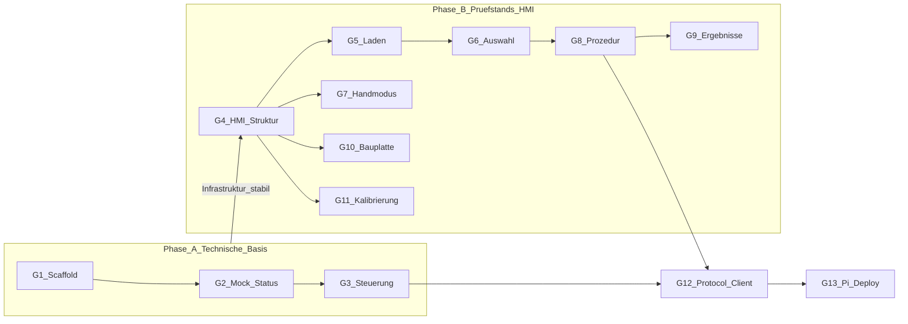

# GUI/HMI Meilensteinplan (überarbeitet)

Zwei Phasen: **Phase A** = technische GUI-Basis mit Mock; **Phase B** = eigentliche Prüfstands-HMI. Noch **kein Code**.

---

## Phasenüberblick




**Gate nach Phase A (Ende G3):**

> **„Die GUI-Infrastruktur funktioniert und wir können jetzt die eigentliche Prüfstands-HMI darauf aufbauen.“**

Konkret: vollständiger Zyklus Browser → Node-Server → `MachineClient`/`MockMachineClient` → Live-Status zurück zur HMI; `moveTo` / Pause / Resume / Stop am PC nachvollziehbar; Browser kennt Mock vs. echt nicht.

---

## Architektur (gilt für alle Meilensteine)

```text
Browser (nur HMI)
    ↓  HTTP + WebSocket
Node Server
    ↓
MachineClient  (Vertrag / Factory)
    ↓
MockMachineClient          ← Phase A und B (früh)
    … später …
ProtocolMachineClient      ← ab G12
    ↓
Simulation / STM32
```

- Browser implementiert **keine** Maschinen-/Motion-Autorität.
- Mock (später echte Maschine) ist Autorität über Zustände und Pose.
- GUI-STOP ≠ Hardware-E-Stop; keine Safety-/E-Stop-Logik in der GUI.
- Kein UART-/Binärprotokoll in frühen GUI-Meilensteinen.

### Technologie (unverändert)


| Schicht                 | Wahl                                  |
| ----------------------- | ------------------------------------- |
| Ziel                    | Raspberry Pi (siehe Hinweis unten)    |
| Runtime                 | Node.js LTS                           |
| Server                  | Express oder schlankes natives `http` |
| Frontend                | Vanilla HTML/CSS/JS                   |
| Live-Status             | WebSocket                             |
| Bundler / SPA-Framework | nein (kein React/Vue)                 |


### Agent-2-Grenzen (explizit)

- Nur `gui/` und ggf. GUI-Dokumentation
- **Keine** Änderungen an `core/`, `tests/`, `simulation/`, CMake
- Keine GUI-Logik in C++
- Keine echte UART-Kommunikation in G1–G11
- Keine eigene Motion-/Machine-State-Autorität im Browser

### Hinweis Raspberry Pi (Doku)

`[docs/Project_Specification.md](docs/Project_Specification.md)` nennt **Pi 3b**; `[AGENTS.md](AGENTS.md)` nennt noch **Pi 5**. Der Plan ändert die Projektdokumentation **nicht**; Stack bleibt schlank genug für schwache Hardware (Pi 3b).

### Abhängigkeit zur Core-Roadmap


| GUI    | Core-Bezug                                                                                                                          |
| ------ | ----------------------------------------------------------------------------------------------------------------------------------- |
| G1–G3  | Fachlich angelehnt an **M5** (`MachineState`, `MotionState`, Pose, `moveTo`/`pause`/`resume`/`stop`) — **ohne** Core-Code zu nutzen |
| G4–G11 | Parallel möglich; Fachfunktionen oft erst sinnvoll mit späteren Core-Milestones (M6+), bis dahin Mock                               |
| G12    | Braucht Core **M12** (Protokoll) + **M13** (Sim-Bridge); entspricht grob Core-**M14**-Absicht                                       |
| G13    | Nach G12; Pi-Hardware                                                                                                               |


---

## Phase A — Technische GUI-Basis

### G1 — GUI Scaffold

**Ziel:** Minimale, am PC startbare HMI ohne Mock-Logik und ohne Navigation.

**Umfang:**

- Ordner `gui/` mit `package.json`, `README.md` (Start: `npm start`)
- Minimaler Node-Server (Express oder natives `http`), statische Dateien aus `public/`
- Eine einfache HMI-Seite (HTML/CSS/JS): Titel, Platzhalter für Status/Steuerung
- Browser-Aufruf lokal (z. B. `http://localhost:…`)

**Nicht-Umfang:**

- Kein `MachineClient`, kein Mock, kein WebSocket
- Keine Menüstruktur, keine Prüfstands-Fachseiten
- Kein Protokoll, kein Core-Bezug im Code

**DoD:** `npm start` → Browser öffnet eine funktionierende (statische) HMI-Seite.

---

### G2 — Mock Machine + Live-Status

**Ziel:** Live-Anzeige eines zeitlich nachvollziehbaren Mock-Maschinenzustands; Client-Vertrag steht.

**Umfang:**

- `MachineClient`-Vertrag (konzeptionell: Status abonnieren / lesen; Commands noch minimal oder stubs)
- `MockMachineClient`: hält `machineState`, `motionState`, `x/y/z`; tickt zeitlich nachvollziehbar (z. B. Idle → kurze Bewegungssimulation oder periodische Pose-Änderung zum Nachweis)
- WebSocket (oder vergleichbar schlank) Server → Browser
- Persistente Statusanzeige auf der einen HMI-Seite: MachineState, MotionState, X/Y/Z
- Factory/`MACHINE_CLIENT=mock` vorbereitet (nur Mock aktiv)

**Nicht-Umfang:**

- Noch keine Bedienbuttons für moveTo/Pause/Resume/Stop (oder nur deaktiviert/Platzhalter)
- Keine Menünavigation
- Kein Protocol-Client

**DoD:** GUI zeigt einen sich verändernden Mock-Maschinenzustand live; Browser weiß nicht, dass es ein Mock ist (nur Server wählt die Implementierung).

---

### G3 — Maschinensteuerung über HMI (M5-äquivalent)

**Ziel:** Erster vollständiger Steuerzyklus HMI → Server → Machine → Status → HMI.

**Umfang:**

- Commands nur aus dem M5-Satz: `moveTo(x,y,z)`, `pause`, `resume`, `stop`
- GUI sendet Commands an den Server; Server delegiert an `MockMachineClient`
- Mock aktualisiert Zustand zeitlich nachvollziehbar (z. B. Active + Moving, Pose nähert sich Ziel, AtTarget/Idle; Pause friert ein; Resume setzt fort; Stop bricht ab)
- Live-Rückmeldung in der Statusanzeige
- Soft-STOP in der HMI immer erreichbar

**Nicht-Umfang:**

- Homing, Jog, Pneumatik, Programme, Force, Fault-Injektion als Produktfeature
- Keine Prüfstands-Menüs
- Keine Safety-/E-Stop-Logik; GUI-STOP ≠ E-Stop
- Browser enthält keine eigene Motion-Autorität (nur Anzeige + Command-Versand)

**DoD:** Am PC: Zielpose setzen und `moveTo` → Bewegung im Mock sichtbar; Pause / Resume / Stop wirken; Status und XYZ aktualisieren sich live. **Phase-A-Gate ist erreicht.**

---

## Phase B — Eigentliche Prüfstands-HMI

Voraussetzung: Phase-A-Gate (G3) erfüllt.

### G4 — Grundlegende HMI-Struktur

**Ziel:** Navigierbare Shell für alle späteren Fachbereiche; Statusleiste bleibt global.

**Umfang:**

- Hauptmenü
- Navigation + „Zurück“
- Globale Statusleiste (MachineState, MotionState, XYZ, Fehlerplatzhalter)
- Seiten-Platzhalter für: Prüftstellen laden, Prüfstellen auswählen, Prüf-/Alterungsprozedur, Prüfergebnisse, Handmodus, Bauplatte wechseln, Kalibrieren
- Bestehende G3-Steuerung sinnvoll erreichbar halten (z. B. Debug-/Hand-Zugang oder in Handmodus-Platzhalter verlinken)

**Nicht-Umfang:** Fachlogik der Unterseiten (nur Platzhalter/Stubs)

**DoD:** Alle Menüpunkte erreichbar; Statusleiste überall sichtbar; Mock-Steuerzyklus aus G3 bleibt nutzbar.

---

### G5 — Prüftstellen laden

**Ziel:** Datei auswählen und laden (GUI-seitig), zurück zum Menü.

**Umfang:** Dateiauswahl; einfache Validierung (z. B. JSON-Struktur-Platzhalter); Laden in GUI-/Server-State; Fehleranzeige; Zurück.

**Nicht-Umfang:** 3D; Anbindung an Core-`TestProgram` (Mock/Platzhalter ok); UART.

**DoD:** Gültige Testdatei laden und im UI bestätigen; ungültige Datei abweisen.

---

### G6 — Prüfstellen auswählen

**Ziel:** Auswahl der zu prüfenden Punkte und Bestätigung.

**Umfang:** Auswahl aus Liste; „Alles auswählen“; Auswahl bestätigen; Zurück. 3D-Auswahl nur als klar markierter Platzhalter/Hinweis.

**Nicht-Umfang:** Volle 3D-Interaktion; echte Core-TestExecutor-Anbindung.

**DoD:** Bestätigte Auswahl ist im GUI-State sichtbar und für spätere Prozedur verfügbar.

---

### G7 — Handmodus

**Ziel:** Manuelle Bedienung gegen denselben `MachineClient` (Mock).

**Umfang:** Geschwindigkeit wählen; Jog ±X/Y/Z (Commands an Client; Mock bewegt); Spreizer aufweiten/schließen (Mock-Flags); Homing-Button (Stub oder einfaches Mock-Homing); Status live.

**Nicht-Umfang:** Echte Homing-Sequenz am STM32; E-Stop.

**DoD:** Jog und Spreizer ändern Mock-Zustand sichtbar; STOP greift; Speed beeinflusst Mock-Bewegung nachvollziehbar.

---

### G8 — Prüf-/Alterungsprozedur

**Ziel:** Bedienablauf der Prozedur gegen Mock (testbarer Fortschritt).

**Umfang:** Modus Prüfen vs. Altern; Eingliederungskraft; Iterationen; Parameteranzeige; Fortschritt; Start / Pause / Fortsetzen / Stop; Hinweis bei Abschluss; Navigation zu Ergebnissen; Zurück.

**Nicht-Umfang:** Echte Force-Control/Core-TestExecutor (Mock simuliert Ablauf); E-Stop.

**DoD:** Kompletter Mock-Prozedurzyklus über die UI steuer- und beobachtbar; Abschluss führt zu Ergebnissen (G9).

---

### G9 — Prüfergebnisse

**Ziel:** Erste Ergebnisdarstellung nach Prozedur.

**Umfang:** Einfache tabellarische/listenbasierte Anzeige von Mock-Ergebnisdaten; Export-Platzhalter (z. B. CSV-Stub); Link vom Prozedurende.

**Nicht-Umfang:** Schwere Diagramm-Libs / aufwendige 3D (Pi-schonend später optional).

**DoD:** Nach G8 sind Ergebnisse sichtbar; Export-Hook dokumentiert oder stubbed.

---

### G10 — Bauplatte wechseln

**Ziel:** Spannsystem bedienen und zurück.

**Umfang:** Spannsystem öffnen/schließen über `MachineClient`/Mock; Statusrückmeldung; Zurück.

**Nicht-Umfang:** Mechanik-Sicherheit jenseits Soft-STOP; echte Pneumatik-Hardware.

**DoD:** Öffnen/Schließen ändert Mock-Status sichtbar.

---

### G11 — Kalibrieren

**Ziel:** Wizard-Gerüst für beide Kalibrierpfade (Fachdetails später).

**Umfang:** Einstieg Messtaster→Bauplatte und Kraftmessdose; schrittweiser Wizard mit Platzhalter-Texten/Schritten; Abschluss zurück zum Menü.

**Nicht-Umfang:** Finale Kalibrieralgorithmen und Sensor-Hardware; UART.

**DoD:** Beide Wizard-Pfade durchklickbar; Schritte klar als Platzhalter gekennzeichnet.

---

## Anschluss echte Kommunikation & Pi

### G12 — ProtocolMachineClient

**Ziel:** Mock austauschbar durch Protokoll-Client ohne Browser-Umbau.

**Voraussetzung:** Core **M12** + **M13**.

**Umfang:** `ProtocolMachineClient` hinter derselben Factory; Anbindung Sim-Bridge; Umschalten `mock|protocol`; gleiche Command-/Status-Shapes.

**Nicht-Umfang:** UART-Treiber/Binärframing selbst erfinden (nutzt `communication/`); STM32-Firmware.

**DoD:** GUI steuert Sim über Protokoll; Browser unverändert bezüglich Mock vs. echt.

---

### G13 — Deployment Raspberry Pi

**Ziel:** Betrieb auf Ziel-Pi.

**Umfang:** Startanleitung; Node LTS; optional Autostart; Ressourcen-Check; Statusrate ggf. drosseln.

**DoD:** HMI auf Pi stabil bedienbar; Grenzen dokumentiert.

---

## Zielstruktur `gui/` (Referenz)

```text
gui/
├── package.json
├── README.md
├── server/
│   ├── index.js
│   ├── machineClient.js          # Vertrag / Factory
│   ├── mock/mockMachineClient.js
│   └── protocol/…                # ab G12
└── public/
    ├── index.html
    ├── css/
    └── js/
        ├── app.js
        ├── statusBar.js          # ab G2/G4
        ├── api.js
        └── pages/                # ab G4
```

---

## Kommunikationsvertrag (inhaltlich, kein UART)

**Commands (G3):** `moveTo`, `pause`, `resume`, `stop` — entspricht Core **M5**.

**Status (G2+):** `machineState`, `motionState`, `x`, `y`, `z` — **M5**.

**Später (Phase B / Core M6+):** Programme, Punktauswahl, ProcessState/Fortschritt, Force, Pneumatik-Ist, Homing, Fault-Details, Kalibrier-Commands.

---

## Empfohlene Reihenfolge nach Freigabe

1. Nur **G1** implementieren und abnehmen
2. Dann **G2**, dann **G3** → Phase-A-Gate
3. Erst danach **G4**, anschließend G5–G11 nach Priorität (Vorschlag: G5→G6→G7→G8→G9, parallel/danach G10/G11)
4. **G12** wenn Core M12/M13 bereit; **G13** auf Pi

**Jetzt:** Plan freigeben — noch keinen Code.