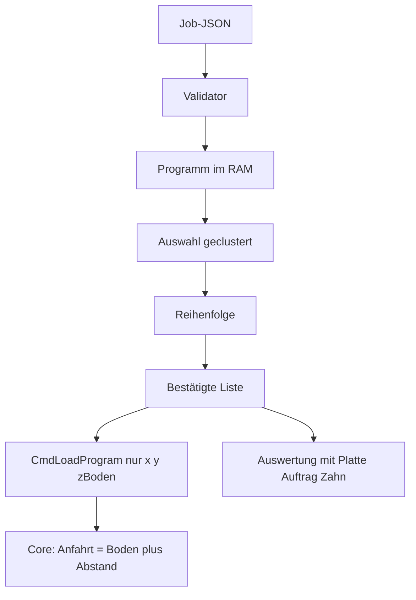

# Job-JSON für Prüfstellen

Die Beispieldatei [Messpunkte_Friktionskraft.json](c:\Users\pauls\Downloads\Messpunkte_Friktionskraft.json) ist die neue Quelle. Alles oberhalb von `job` (Schema, Koordinatensystem, `calculation`, `complete`) wird ignoriert, auch `calculation.floorClearanceMM`. Der Abstand kommt ausschließlich aus den Parametern.

Koordinaten bleiben Bauplattenkoordinaten: Ursprung Mitte der Platte, Z auf der Oberfläche, gleiche Achsrichtungen. Die bestehende Kalibrierung (`plateOrigin`, Gierwinkel, `toolOffset`) transformiert sie wie bisher. Es gibt keine zweite Umrechnung.

## Datenmodell

Neuer Validator in [gui/server/program/validateTestProgram.js](gui/server/program/validateTestProgram.js). Unbekannte Felder werden übergangen, fehlende Pflichtfelder abgelehnt. Das alte flache Format (`version` / `programName` / `testPoints`) wird abgelehnt.

Pflichtpfad:

- `job.buildJobNumber` — nicht-leerer String
- `job.plates[]` — mindestens eine Platte, `plate` eindeutig
- `orders[]` — `orderUid` eindeutig innerhalb der Platte
- `teeth[]` — `toothNumber` ganze Zahl, eindeutig innerhalb des Auftrags, `point.x/y/z` endlich
- mindestens ein Zahn in der Datei

Die Datei darf mehr als 32 Zähne enthalten. Erst die bestätigte Auswahl ist auf 32 begrenzt (`kMaxTestPoints` / `CmdLoadProgram`).

Normalisierte Form, Reihenfolge der Datei bleibt erhalten:

- `buildJobNumber`
- `plates[].plate`
- `plates[].orders[].orderUid`
- `teeth[]`: `toothNumber`, `x`, `y`, `z` (Boden)

Stabiler Schlüssel: `plate + orderUid + toothNumber`.

## Auswahl und Reihenfolge

[gui/server/program/selectionStore.js](gui/server/program/selectionStore.js) ersetzt die reine `sequenceNumber`-Auswahl.

Drei sich ausschließende Modi:

- **Automatisch** (Default): Platten in Dateireihenfolge, darin Aufträge in Dateireihenfolge, darin nur angehakte Zähne nach `toothNumber` aufsteigend.
- **Auftragsreihenfolge**: Platten bleiben in Dateireihenfolge. Innerhalb jeder Platte sortiert der Benutzer die Aufträge (Hoch/Runter). Zähne eines Auftrags laufen weiter von der kleinsten zur größten Nummer. Abgewählte Zähne fallen weg.
- **Zahnreihenfolge**: nur die angehakten Zähne, einzeln per Hoch/Runter. Neu angehakte Zähne hängen hinten an.

Die Vorschau `1…n` mit Platte, Auftrag, Zahn, X/Y, Z-Boden und Z-Anfahrt ist vor dem Bestätigen sichtbar und wird mit der Bestätigung eingefroren. `sequenceNumber` entsteht erst hier als Laufindex. An- und Abwählen bleibt in jedem Modus möglich.

## GUI

[gui/public/js/pages/selectPoints.js](gui/public/js/pages/selectPoints.js) und [gui/public/css/app.css](gui/public/css/app.css):

- Kopf mit Baujob-Nummer
- Blöcke Platte, darin Karten je `orderUid`, darin Zahnzeilen mit Checkbox, Nummer und Koordinaten
- Moduswahl und Hoch/Runter nur im aktiven Modus (keine neue Drag-Bibliothek, bedienbar am Pi)
- feste Vorschau der Prüfreihenfolge unter der Clusteransicht

[gui/public/js/pages/loadPoints.js](gui/public/js/pages/loadPoints.js) zeigt nach dem Laden dieselbe Zuordnung statt der alten Seq/Name-Tabelle.

## Teach

[gui/server/program/programFiles.js](gui/server/program/programFiles.js) und der Dialog in [gui/public/js/components/manualControls.js](gui/public/js/components/manualControls.js) schreiben `schemaVersion: 2` mit `job`. Abfragen: Baujob-Nummer, Platte, Auftrags-UID, Zahnnummer. Anhängen legt fehlende Platte oder fehlenden Auftrag an und lehnt eine doppelte Zahnnummer ab.

Die angefahrene Pose wird als JSON-Punkt gespeichert, also als Boden (maximale Tiefe), nicht als Anfahrhöhe. Der Dialog sagt das ausdrücklich, damit die Teach-Datei dieselbe Bedeutung hat wie die Firmendatei. Die Prüfung fährt später `z + Abstand` an.

## Z-Abstand und Tiefengrenze

Neuer Maschinenparameter `point_z_clearance_mm`, Default **2 mm**, Bereich 0 bis 20, in den Parametern als „Z-Abstand Anfahrt“. Er wird ans Ende von `MachineConfig` gehängt (ein Float, Wire-Größe +4). Betroffene Stellen: [core/MachineConfig.hpp](core/MachineConfig.hpp), [communication/Payloads.hpp](communication/Payloads.hpp), [communication/PayloadCodec.cpp](communication/PayloadCodec.cpp), [communication/ProtocolSpec.hpp](communication/ProtocolSpec.hpp), [simulation_bridge/ConfigMapping.hpp](simulation_bridge/ConfigMapping.hpp), [gui/server/protocol/m12Codec.js](gui/server/protocol/m12Codec.js), [gui/server/config/parameterCatalog.js](gui/server/config/parameterCatalog.js). Bestehende `machine-config.json` ohne das Feld bekommen den Default beim Laden. Simulation und STM32 müssen mit diesem Stand neu gebaut werden.

`CmdLoadProgram` bleibt `x, y, z` und transportiert den **Boden**. In [core/ProcedureController.cpp](core/ProcedureController.cpp) gilt danach:

- Anfahr-Z = Boden + Abstand. Grobe Anfahrt bleibt `approach_distance` über dieser Anfahr-Z. Die feine Anfahrt (`commandFineApproach`) endet auf der Anfahr-Z.
- Während der feinen Anfahrt und der pneumatischen `Clamp`-Phase wird kein Z-Soll unter den Boden kommandiert.
- Kraft-Einsitz (`InsertInitial`) und die Messzyklen (`TestOrAge`) dürfen unter den Boden fahren. Die bestehenden Z-Fenster der Messung beziehen sich weiter auf die angefahrene Höhe, nicht auf den Boden.

Safe-Z in [core/SafeZ.hpp](core/SafeZ.hpp) und der GUI-Spiegel [gui/server/coord/safeZ.js](gui/server/coord/safeZ.js) nehmen die Anfahrhöhe (`Punkt.z + Abstand`), damit der Freifahrt-Puffer über dem tatsächlich angefahrenen Punkt liegt.

## Auswertung

Die bestätigte, geordnete Liste ist die Quelle für Namen und Zuordnung, nicht der Index in der Gesamtdatei. Jede Kurve und jede Ergebniszeile trägt Baujob, Platte, `orderUid`, Zahnnummer, Boden-Z und Anfahr-Z. Angepasst werden [gui/server/procedure/protocolProcedureAdapter.js](gui/server/procedure/protocolProcedureAdapter.js), [gui/server/results/forcePathAnalysis.js](gui/server/results/forcePathAnalysis.js), [gui/server/results/resultsExport.js](gui/server/results/resultsExport.js) und die Anzeige in [gui/public/js/pages/results.js](gui/public/js/pages/results.js) sowie die laufende Prüfstelle in der Prozeduransicht.

## Tests und Doku

- Validator, Teach-Schreiben, die drei Sortiermodi inkl. Abwahl und der 32er-Grenze der Auswahl
- Core: feine Anfahrt auf Boden+Abstand, kein Soll unter dem Boden in feiner Anfahrt/Clamp, Einsitz darf darunter liegen
- Codec-Länge und Parameter-Default
- Smoke-Skripte, die heute das alte `testPoints`-JSON hochladen, auf einen kleinen Job-Helfer umstellen

Kurzer Abschnitt in [docs/M18_Procedure.md](docs/M18_Procedure.md): Job-Datei, Anfahr-Z und die begrenzte Tiefengrenze. Die veraltete Wire-Größe dort wird auf den neuen Wert nachgezogen.