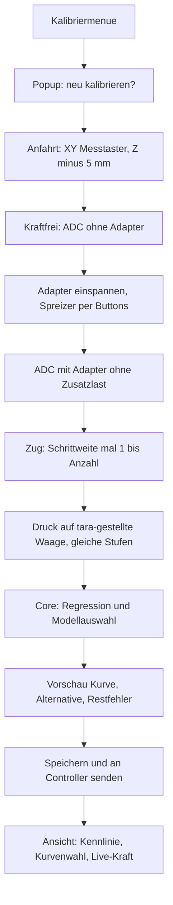

# Kraftsensor-Kalibrierung und einstellbarer Messbereich

Zwei Meilensteine, nacheinander. Zuerst der Wizard mit festem Default-Plan (5 Stufen à 500 g). Danach die Parameter, mit denen Messbereich, harte Grenze, Stufenanzahl und Schrittweite geändert werden. Der Wizard in A ist schon datengetrieben, damit B ihn nicht neu schreiben muss.

## Einordnung

Geometrie-Kalibrierung (MCS, Bauplatte, Messtaster) ist fertig. **Kraftmessdose kalibrieren** in [gui/public/js/pages/calibrate.js](gui/public/js/pages/calibrate.js) ist deaktiviert. Der Core sieht nur Newton auf `HostInputs`. ADC-Skalierung ist Host-Sache ([docs/M18_Procedure.md](docs/M18_Procedure.md), S6).

Lokale, noch nicht committete Firmware (Phase 1–2, Chat [STM32 integration plan](93c99791-3ba2-4a4c-adbe-024534a8324f)) wird nicht angefasst. `AdcScaler` mappt heute fest `0…4095` auf `−50…+50 N`.

# Meilenstein A — Kalibrier-Wizard

## Kennlinie

Die Kurve wird nicht durch die Messpunkte gelegt. Eine solche Interpolation würde jeden Wäge- und ADC-Fehler als Sensorkennlinie ausgeben. Stattdessen rechnet der Core eine Ausgleichsrechnung nach der Methode der kleinsten Fehlerquadrate, wie im Messtechnik-Auszug zur Regressionsanalyse: die Kurve minimiert die Summe der Abstandsquadrate zur Referenzkraft, sie muss die Punkte nicht treffen.

Abhängige Größe ist die Referenzkraft in Newton, unabhängige Größe der ADC-Zählwert. Gesucht ist die Messfunktion `F = f(ADC)`. Die Referenzmasse ist die genauere Größe, der ADC das verrauschte Signal. Trotzdem wird die Kraft auf den ADC regressiert, weil das Gerät später aus dem ADC eine Kraft ausgeben muss. Die Rohpunkte bleiben mit gespeichert, damit die Rechnung in einer Arbeit nachvollzogen werden kann.

Zwei ineinander geschachtelte Modelle, beide mit denselben Normalgleichungen `(XᵀX) β = Xᵀy`:

- Gerade: `F = β0 + β1 · adc`
- Ausgleichspolynom Grad 2: `F = β0 + β1 · adc + β2 · adc²`

Höher als Grad 2 wird nicht gerechnet. Bei etwa elf Punkten würde ein kubisches Polynom das Rauschen mitmodellieren. Der Auszug bleibt beim quadratischen Ansatz, sobald die Gerade den Restfehler nicht mehr trägt.

Numerisch wird der ADC vor dem Fit zentriert und skaliert. Gespeichert werden die Koeffizienten wieder in rohen ADC-Counts, plus Grad, Pearson-r der Geraden, R², maximaler Restfehler und die Punktliste.

### Welche Kurve gilt

Die Gerade ist der Normalfall. Das Polynom wird nur übernommen, wenn es den Fehler über eine Zufallsschwankung hinaus verkleinert. Drei Bedingungen, alle müssen gelten:

1. Mindestens sechs Punkte, damit nach drei Koeffizienten noch Freiheitsgrade übrig sind. Darunter bleibt es bei der Geraden.
2. Partieller F-Test mit α = 0,05: der zusätzliche quadratische Term senkt die Restquadratsumme stärker, als es bei reinem Rauschen zu erwarten ist. Kritische F-Werte für einen Zählerfreiheitsgrad stehen als kleine Tabelle im Core, ohne Statistikbibliothek.
3. Praktische Relevanz: der maximale Betragsrest der Geraden ist größer als **0,3 % der Messspanne**. Die Spanne ist der doppelte Messbereich. Bis Meilenstein B gilt der Default ±30 N, also 60 N und eine Schwelle von 0,18 N. Das entspricht der im STM32-Plan genannten Nichtlinearität der Dose von etwa ±0,3 % FS. Liegt die Gerade darunter, beschreibt ein Polynom eher den Wägefehler als den Sensor.

Pearson-r wird immer mit ausgegeben. Er allein schaltet das Modell nicht um: ein r nahe 1 stützt die Gerade, ein kleineres r kann auch nur Rauschen sein.

Die übernommene Kurve muss im Kalibrierintervall streng monoton steigen (Zug zu Druck, ADC nach oben). Ein quadratisches Polynom mit Wendung in diesem Intervall wird verworfen, es bleibt bei der Geraden. Hat auch die Gerade die falsche Steigung, gibt es keinen Commit.

Einzelne Rohpunkte dürfen um die Kurve streuen. Sie werden nicht gelöscht und nicht auf die Kurve gezogen. Liegt der maximale Restfehler des gewählten Modells über **1 % der Messspanne** (Default 0,6 N), wird nicht gespeichert. Die Vorschau nennt den schlechtesten Punkt und fordert zum Wiederholen auf.

Hysterese zwischen Zug und Druck kann eine einzige Funktion von ADC nicht abbilden. Die Vorschau zeigt die Vorzeichen der Reste je Richtung. Systematisch entgegengesetzte Reste sind ein Hinweis, kein zweites Modell.

### Vorschau

Das Diagramm zeigt die Messpunkte, die gewählte Kurve und die verworfene Alternative gestrichelt, dazu r, R², maximalen Restfehler und einen Satz, warum dieses Modell gilt. Beispiel: die Gerade bleibt, weil der quadratische Term den Restfehler nicht über die Zufallsgrenze hinaus senkt.

## Wahl der wirksamen Kurve

Im Kalibriermenü, nicht nur am Ende des Wizards, legt der Bediener fest, welche Kurve die Messfunktion ist. Die Wahl bleibt gespeichert und kann jederzeit geändert werden.

- **Automatisch.** Default nach einem Wizard-Lauf. Es gilt die Auswahl nach F-Test und 0,3-%-Schwelle.
- **Gerade fest** oder **Polynom Grad 2 fest.** Überschreibt F-Test und 0,3-%-Schwelle. Die Kennzahlen bleiben sichtbar. Liegt der Restfehler über 1 % der Messspanne, warnt die GUI und übernimmt die Kurve erst nach einer zweiten Bestätigung. Beide Optionen gibt es nur, wenn ein Punktesatz aus dem Wizard gespeichert ist. Sonst sind sie deaktiviert.
- **Externe Gleichung.** Für einen anderen Sensor oder eine Kurve, die außerhalb des Prüfstands ermittelt wurde. Kein Wizard nötig. Die gespeicherten Wizard-Punkte bleiben liegen, damit später wieder auf Automatisch, Gerade oder Polynom zurückgeschaltet werden kann. Gegen diese Punkte wird der Restfehler nur angezeigt, nicht als Ablehnung benutzt.

Die externe Gleichung hat dieselbe Form wie die interne Messfunktion:

`F_sensor [N] = β0 + β1·x + β2·x²`

`F_sensor` ist die Dosenkraft, Zug negativ. `β2` darf 0 sein, dann ist es eine Gerade. `x` ist wählbar:

- ADC-Counts des Z-Kanals, 0…4095
- Spannung in Volt, 0…3,3 V

Der Core rechnet eine Spannungs-Gleichung auf ADC-Counts um (`V = adc · 3,3 / 4095`) und speichert nur diese Form. Auswertung und Firmware-Vertrag bleiben ein Polynom über Counts.

Abgelehnt wird eine manuelle oder externe Kurve nur, wenn Koeffizienten nicht endlich sind oder die Kurve im ADC-Bereich 0…4095 nicht streng monoton steigt. Eine solche Funktion würde die Kraftrichtung umkehren.

## Kalibrierplan

Der Wizard läuft eine Liste von Sollmassen ab, nicht eine fest einprogrammierte Fünf. Default, solange Meilenstein B die Parameter noch nicht freigibt:

- **5 Punkte je Richtung**
- **Schrittweite 500 g**
- Sollwerte Zug und Druck: 500, 1000, 1500, 2000, 2500 g

Dieselbe Schleife benutzt später die Werte aus den Parametereinstellungen. Die Protokollnachricht trägt bis zu **16 Punkte je Richtung** plus den Nullpunkt, damit eine größere Stufenzahl ohne neue Message-ID geht.

## Gramm, Umrechnung im Core

Der Bediener tippt die Kalibriermasse in **Gramm** (positive Zahl). Die Richtung kommt vom Wizard-Schritt.

Der Core rechnet mit `g0 = 9,80665 m/s²`:

`F_sensor [N] = (m [g] / 1000) * g0`

Zug wird negativ, Druck positiv (Dose: −25 N ≈ 0,3 V, 0 N ≈ 1,5 V, +25 N ≈ 2,6 V). 500 g sind 4,903 N. Die GUI rechnet nicht in Newton um.

## ±100 g Fenster

Beim Bestätigen muss der eingetippte Wert im Intervall **Sollstufe ± 100 g** liegen. Sonst wird der Punkt nicht übernommen. Die GUI zeigt einen Warnhinweis und fordert auf, die Kalibrierkraft zu ändern und im 100-g-Fenster zu bleiben. Dieselbe Prüfung lehnt der Core ab.

Die Schrittweite muss **größer als 200 g** sein, damit benachbarte Fenster sich nicht überlappen. Der Default 500 g erfüllt das. Eine kleinere Schrittweite lehnt die Parameterprüfung in Meilenstein B ab.

Die Monotonie gilt für die Ausgleichskurve, nicht für jeden Rohpunkt. Kleine ADC-Streuung ist der Grund für die Regression.

## Vorzeichen zur Prozedur

Die Kennlinie spricht die Dosensprache (Zug negativ). Die Prüfprozedur erwartet **Zug = positives Fz** ([docs/M18_Procedure.md](docs/M18_Procedure.md), S6). Der Wechsel passiert nur an der Host-Grenze: `HostInputs.force.fz = −F_sensor`.

## Protokoll

StatusReport bleibt **41 Byte**. Neu, nur Simulation in diesem Meilenstein:

- `CmdSetForceCalibration` `0x59`: Stützstellen mit ADC-net, Masse in g, Richtung, Sollstufe in g, plus die Wahl automatisch / Gerade / Polynom. Core wandelt um, prüft das 100-g-Fenster und die Monotonie.
- `CmdSelectForceCurve` `0x5A`: jederzeit die wirksame Kurve wechseln. Bei externer Gleichung die drei Koeffizienten und die Einheit ADC oder Volt, ohne neue Punkte.
- `MsgRawAdc` `0xA4`: drei `uint16` plus Gültig-Flag. Der Wizard liest den Z-Rohwert hier.
- `MsgForceCalibration` `0xA5`: wirksame Wahl, Grad, Koeffizienten, r, R², maximaler Restfehler und die Punkte, falls vorhanden.

Fx/Fy werden nicht kalibriert.

## Ablauf

Tara in ADC-Counts:

- `adc_free`: keine Kraft, kein Adapter. Wird Stützpunkt 0 g.
- `adc_adapter`: Adapter eingespannt, keine Zusatzlast.
- `adapter_delta = adc_adapter − adc_free`
- Messpunkt: `adc_net = adc_now − adapter_delta`, Masse = eingetippte Gramm, Vorzeichen aus dem Schritt.

Jog aller Achsen und Spreizer sind ab dem Ende der Anfahrt auf jedem Schritt sichtbar. Während der automatischen Anfahrt ist Jog gesperrt. Soft-STOP bricht Anfahrt und Wizard ab.

Anfahrt: gültiges MCS, referenziert, `probe_center` vorhanden. Ziel `Z = −5 mm` (oberer Schalter ist `Z = 0`), XY = Messtastermitte. Fehlt die Geometrie, Abbruch mit Hinweis auf die bestehende Kalibrierung.

Druck-Hinweis: Waage vorher auf null stellen. Eingetragen wird nur die zusätzliche Kontaktkraft in Gramm.

## Software-Schnitt Meilenstein A

- Neu: [core/ForceCalibration.hpp](core/ForceCalibration.hpp) und `.cpp`. Tests in `tests/force_calibration_tests.cpp`: Gramm-Umrechnung, ±100-g-Ablehnung, Gerade wird bei einer linearen Kennlinie mit Rauschen gewählt, das quadratische Polynom nur bei einer deutlich gekrümmten Kennlinie, Commit-Verweigerung bei zu großem Restfehler im Automatikmodus, manuelle Festlegung und Umrechnung einer Spannungs-Gleichung auf ADC-Counts. Die synthetische Dose bleibt (−25 N / 0,3 V, 0 N / 1,5 V, +25 N / 2,6 V, 12 Bit, 3,3 V, Teiler 4095).
- Simulation: synthetische Fz-Counts aus derselben Kennlinie. Nach Commit setzt der Sim-Host `HostInputs.fz`. Fx/Fy bleiben linear.
- GUI: Force-Modus in [gui/public/js/pages/calibrate.js](gui/public/js/pages/calibrate.js), Jog aus [gui/public/js/components/jogPanel.js](gui/public/js/components/jogPanel.js), Spreizer aus [gui/public/js/components/manualControls.js](gui/public/js/components/manualControls.js). Diagramm als SVG wie in [gui/public/js/pages/results.js](gui/public/js/pages/results.js). In der Kennlinienansicht die vier Quellen Automatisch, Gerade, Polynom und externe Gleichung, dazu Live-Anzeige Fx/Fy qualitativ und Fz in Gramm und Newton.
- Persistenz: Block `forceZ` in [gui/server/config/calibrationStore.js](gui/server/config/calibrationStore.js) mit Punktesatz, beiden Fits, wirksamer Wahl und optional der externen Gleichung. Connect schiebt die wirksame Kurve an den Controller. Abbruch vor dem Speichern eines Wizard-Laufs verwirft nur die Sitzung.
- Doku: Abschnitt in [docs/Calibration.md](docs/Calibration.md) mit Host-Vertrag für den Firmware-Agenten. Keine Dateien unter `firmware/`.

# Meilenstein B — Messbereich und Kalibrierplan in den Parametern

Erst nach Abschluss von A.

Heute ist ±50 N fest in [core/SafetyLimits.hpp](core/SafetyLimits.hpp), im Watchdog [core/ForceWatchdog.hpp](core/ForceWatchdog.hpp), in den Kollisionsdefaults von [core/MachineConfig.hpp](core/MachineConfig.hpp) (`retract_N`, `contact_N`, `measure_N`) und im Katalog [gui/server/config/parameterCatalog.js](gui/server/config/parameterCatalog.js) (`max: 50`). Tests und die Sim-Plant-Obergrenze hängen daran. Die Plant-Obergrenze bleibt **über** der eingestellten harten Grenze, damit `ForceHardLimit` weiter testbar ist.

## Messbereich und harte Grenze

Neue Felder in den Parametereinstellungen ([gui/public/js/pages/parameters.js](gui/public/js/pages/parameters.js)), Gruppe Kraft:

- **Messbereich** in Newton, Betrag, alle Achsen. Default **30**. Kalibrierpunkte und `target_force_N` dürfen ihn nicht überschreiten.
- **Harte Sicherheitsgrenze** in Newton, Betrag. Default **30**. Auslöseschwelle des Watchdogs. Muss **kleiner oder gleich** dem Messbereich sein. Reject, kein stilles Klemmen.

Beide dürfen **über 30 N** gestellt werden, wenn sich der Sensor später ändert. Die `constexpr`-Werte in `SafetyLimits` sind nur noch eine **Notbremse von 500 N** gegen Tippfehler, nicht der Messbereich der heutigen Dose. 40 N, 50 N oder 100 N sind zulässige Einstellungen. Darüber lehnt der Core ab.

Kollisionsdefaults, die heute 50 N sind, werden auf 30 N gesetzt, passend zum neuen Default. Hebt der Bediener den Messbereich später an, dürfen die Kollisionsschwellen bis zu diesem Messbereich mitgezogen werden. Sie dürfen ihn nicht überschreiten.

Diese beiden Werte gehen in `MachineConfig` und damit in `CmdSetMachineConfig`. Die Wire-Größe (heute 288 Byte) ändert sich **nur in Meilenstein B**. StatusReport bleibt 41 Byte. Firmware spricht M12 noch nicht; `firmware/` wird nicht editiert. Die Doku weist den Firmware-Agenten darauf hin, dass der lineare `AdcScaler` (±50 N) für X/Y bis zu dessen Anpassung nicht zum eingestellten Messbereich passt.

## Anzahl und Schrittweite

Dieselben Parametereinstellungen, ebenfalls Gruppe Kraft. Sie steuern den nächsten Wizard-Lauf. Eine schon gespeicherte Kennlinie bleibt gültig, bis neu kalibriert wird.

- **Anzahl Kalibrierpunkte je Richtung:** ganze Zahl, Default **5**, erlaubt **1…16**.
- **Schrittweite:** Gramm, Default **500**, muss **größer als 200** sein, weil das Fenster ±100 g bleibt.

Sollstufen sind `1 × Schritt` bis `Anzahl × Schritt`, in Zug und in Druck. Beispiel: 3 Punkte bei 1000 g ergeben 1000, 2000 und 3000 g.

Die schwerste Stufe, umgerechnet in Newton, muss **im eingestellten Messbereich** liegen. 5 × 500 g ≈ 24,5 N passt in den Default 30 N. Wer den Sensor vergrößert, hebt zuerst den Messbereich und danach bei Bedarf Schritt oder Anzahl. Ein Plan, dessen letzte Stufe über dem Messbereich liegt, wird beim Speichern der Parameter abgelehnt.

Liegt die letzte Stufe deutlich unter dem Messbereich, zeigt die GUI einen Hinweis, dass die Ausgleichskurve dort nur fortgeschrieben wird und nicht mehr durch Messpunkte belegt ist. Das blockiert das Speichern nicht.

Anzahl und Schrittweite braucht nur der Wizard auf dem Pi. Sie stehen in der Parameterdatei, gehen aber **nicht** in den MachineConfig-Frame. Der Core sieht sie indirekt: jede Sollstufe und das 100-g-Fenster stehen in `CmdSetForceCalibration`.

Senkt ein neuer Messbereich eine vorhandene Kennlinie unter ihren äußersten Punkt, wird die gespeicherte Z-Kalibrierung ungültig und der Wizard muss neu laufen. Anheben des Messbereichs allein löscht die Kennlinie nicht.

Tests und Docs ziehen Default ±30 N, die Notbremse 500 N und die neue Config-Größe nach.

## Bewusst außerhalb

- STM32 HAL, `AdcScaler`, DMA, UART (Vertrag nur in der Doku)
- Quantitative Kalibrierung von Fx/Fy
- Meilenstein B nicht zusammen mit A implementieren

