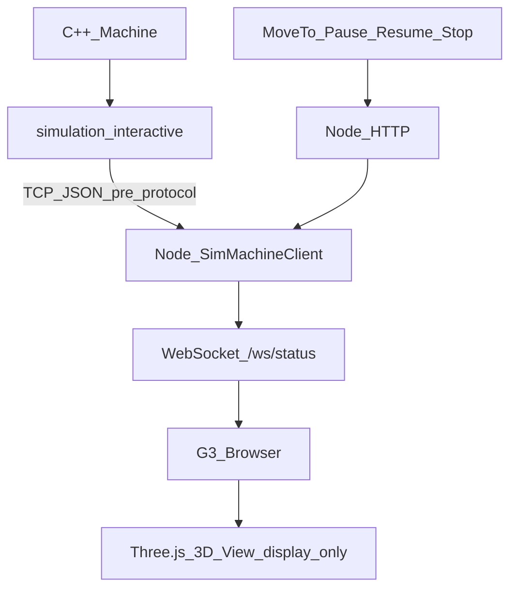

# M8.5 / G3.5 — Interaktiver GUI↔Core-Sim Integrations-Gate (überarbeitet)

## Ausgangslage


| Schicht    | Ist-Zustand                                                                                          |
| ---------- | ---------------------------------------------------------------------------------------------------- |
| Core M1–M7 | Stabil: `Machine` mit `moveTo` / `pause` / `resume` / `stop` / `tick` / States / Pose                |
| M8 Sim     | [simulation/main.cpp](simulation/main.cpp): einmaliger `TestExecutor`-Demo-Lauf — bleibt unverändert |
| G3 GUI     | HTTP Commands + WS Status; Steuerung vorhanden; Pose nur textuell; Mock mit **JS-Kinematik**         |
| Roadmap    | M8 → **M9 Force** … → M12 Protocol → M13 Bridge → M14 GUI                                            |


**Lücke:** G3 bewegt den Mock in JavaScript; Core-Sim ist nicht interaktiv an die GUI angebunden.




## Einordnung (kein Umnummerieren von M9+)

- Core-Roadmap: **M8.5 — Interactive Sim Host + pre-protocol GUI bridge** (zwischen M8 und M9)
- GUI-Plan: **G3.5 — SimMachineClient + Three.js TCP viewport** (nach G3, vor G4)

M9 bleibt Force-Stub. M12/M13 bleiben das **formale** Kommunikationsprotokoll. M8.5-TCP/JSON ist **ausdrücklich nur temporärer Pre-Protocol-Simulations-Transport** und wird später durch M12/M13 ersetzt — **keine Vermischung** mit `communication/`.

Steuerung: **nur `Machine`**, niemals `TestExecutor` in M8.5/G3.5.

---

## Verbindliche Definition of Done (M8.5 / G3.5)

1. **Bewegungsberechnung ausschließlich in** `Machine` → `MotionPlanner` → `Axis`. In JavaScript (Node und Browser) gibt es **keine** Interpolation, keine Geschwindigkeitsintegration, keine Kinematik und keine eigene Pose-Simulation.
2. **G3 steuert direkt** `Machine::moveTo` / `pause` / `resume` / `stop` über den Sim-Host. **Kein** `TestExecutor` im Gate-Pfad.
3. `**simulation_interactive` läuft als eigener Prozess** unabhängig von der GUI (GUI optional; Host allein start-/lauffähig).
4. **TCP/JSON** ist dokumentierter **temporärer Pre-Protocol-Transport**; getrennt von späterem M12/M13; kein `communication/`-Modul in M8.5.
5. **Keine Änderungen an Core M1–M7**; keine Force-/Safety-/HAL-/UART-Implementierung.
6. **Keine G4-Menüstruktur**.
7. **3D-TCP-Darstellung** in der bestehenden G3-HMI via **Three.js lokal per npm** — rein visuell; TCP nur als **Punkt**; **keine Trajektorie** in M8.5.
8. **Verifikation:**
  - nacheinander **X → Y → Z** (drei Richtungen),
  - zusätzlich ein **kombinierter XYZ-Move** (ein `moveTo` mit gleichzeitig gesetztem ΔX/ΔY/ΔZ),
  - plus Pause/Resume/Stop,
  - sichtbar im 3D-Viewport nachvollziehbar.
9. Bestehende CTests M1–M7 und M8-`simulation.exe` (Exit 0) bleiben grün/unverändert im Verhalten.

---

## Architekturentscheidungen (fest)

1. Neues CMake-Target `**simulation_interactive**`; M8-[simulation/main.cpp](simulation/main.cpp) unangetastet.
2. Host: `Machine` erzeugen; TCP-Server (localhost, Port z. B. `8765`); festes `dt`; `setHostInputs` Stub (Force=0, e_stop=false, **ohne Auswertung**) → `**machine.tick(dt)`** → Statuszeile senden.
3. Commands aus Socket → ausschließlich `machine.moveTo` / `pause` / `resume` / `stop`.
4. GUI: `MACHINE_CLIENT=sim` → `SimMachineClient` (TCP); Mock bleibt Default/Offline.
5. Browser: Three.js (npm) liest nur WS-`x/y/z` und setzt die TCP-Punkt-Position — **Source of Truth = C++ Core**.
6. **Koordinatensystem (fest):** Core-Maschinenachsen mapen **1:1** in die Three.js-Szene als **Z-up**:
  - `tcp.position.set(status.x, status.y, status.z)`
  - `camera.up.set(0, 0, 1)` (nicht Three.js-Default Y-up)
  - +X / +Y / +Z Achsen farblich getrennt am Ursprung
  - keine Spiegelung, keine Achsenvertauschung außer dieser dokumentierten Z-up-Kamerakonvention

## Nachrichtenvertrag (ad-hoc Pre-Protocol, G3-aligned)

Status (Host → Client):

```json
{"type":"status","machineState":"Active","motionState":"Moving","x":1.2,"y":3.4,"z":0.5}
```

Commands (Client → Host):

```json
{"type":"command","command":"moveTo","x":10,"y":0,"z":0}
{"type":"command","command":"pause"}
{"type":"command","command":"resume"}
{"type":"command","command":"stop"}
```

Newline-delimited JSON. Semantik = Core-`Machine` (Stopped → Resume wirkungslos; neues `moveTo` erlaubt).

---

## TCP-Visualisierung (G3.5) — Three.js 3D-Viewport

Die bestehende G3-HMI erhält einen **einfachen interaktiven 3D-Viewport**.

**Technik**

- Browser-Canvas / WebGL
- **Three.js lokal per npm** in `gui/` (`dependencies`); Auslieferung über Node-Static oder Bundle — **kein CDN**
- keine eigene 3D-Engine
- **keine** Kinematikberechnung in JavaScript

**Darstellung**

- X-, Y- und Z-Achse (Z-up, siehe Koordinatensystem oben)
- Maschinenursprung
- aktueller TCP **nur als Punkt** (kleines Point/Sprite bzw. minimale Markierung — keine große Kugel-„Maschine“)
- einfache Verbindung Ursprung → TCP
- aktuelle X/Y/Z-Koordinaten als Text (HUD oder Overlay)
- **keine Trajektorie** in M8.5 (bewusst weggelassen; später optional)

**Interaktion**

- Kamera rotieren, Zoom, Pan (z. B. `OrbitControls`)
- Reset der Ansicht

**Datenfluss**

```text
C++ Machine
    ↓
simulation_interactive Host
    ↓ TCP/JSON (pre-protocol)
Node.js SimMachineClient
    ↓
WebSocket /ws/status
    ↓
Browser
    ↓
Three.js 3D View (display-only)
```

---

## Konkrete Dateiänderungen

### Simulation

- Neu: `simulation_interactive/main.cpp` (+ ggf. `CMakeLists.txt`)
- Root-[CMakeLists.txt](CMakeLists.txt): `add_subdirectory` / Target
- README/Kommentar im Host: Transport = **temporary pre-protocol**, not M12
- **Nicht ändern:** Core M1–M7, M8-`simulation/main.cpp`

### GUI

- Neu: `gui/server/sim/simMachineClient.js`
- [gui/server/machineClient.js](gui/server/machineClient.js): `case 'sim'`
- [gui/package.json](gui/package.json): `three` als npm-Dependency
- [gui/public/](gui/public/): Three.js Viewport (HTML/JS/CSS), TCP als Punkt, Z-up
- [gui/README.md](gui/README.md): Startreihenfolge Host → `MACHINE_CLIENT=sim npm start`; DoD inkl. X→Y→Z und kombinierter XYZ-Move; Pre-Protocol-Hinweis; Koordinatensystem
- Mock unverändert

### Pläne

- Core-Roadmap M8.5-Abschnitt + Todo
- GUI-Plan G3.5-Abschnitt + Todo (vor G4; G12 bleibt echtes Protokoll)

---

## Explizit außerhalb M8.5 / G3.5

- Force, Force-Control, XY-Korrektur (M9/M10)
- Safety / E-Stop-Auswertung (M11)
- `communication/`, UART, STM32, formales M12/M13-Protokoll
- TestExecutor-Programmlauf in diesem Gate
- G4-Menüs / Phase-B-HMI
- Änderungen an bestehender M1–M7-Core-Semantik

---

## Risiken


| Risiko                      | Mitigation                                                                       |
| --------------------------- | -------------------------------------------------------------------------------- |
| Ad-hoc JSON vs M12          | Dokumentiert als Pre-Protocol; später ersetzen                                   |
| JS versehentlich integriert | `sim`-Pfad: nur Status cachen/forwarden; Three.js nur `mesh.position.set(x,y,z)` |
| Three.js-Abhängigkeit       | nur npm in `gui/`; Core bleibt frei                                              |
| Stopped-Semantik            | UI-Hinweis: nach Stop neues MoveTo                                               |
| Achsenverwirrung Y-up/Z-up  | feste Doku + `camera.up = (0,0,1)` + 1:1 Positionsmapping                        |


---

## Implementierungsreihenfolge

1. Roadmaps M8.5 / G3.5 inkl. verbindlicher DoD und Pre-Protocol-Klausel
2. `simulation_interactive` (eigenständiger Prozess, Machine-only)
3. `SimMachineClient` + Factory `sim`
4. Three.js (npm) 3D-Viewport: Z-up, TCP-Punkt, ohne Trajektorie
5. Gate-Test: X→Y→Z, kombinierter XYZ-Move, Pause/Resume/Stop; CTest + M8-Sim-Regression

