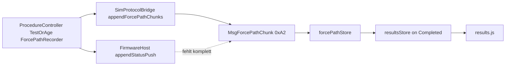

# Messauswertung: Analyse und Implementierungsplan

## Analyse: Warum die GUI leer bleibt

### Datenfluss heute

### Root Causes (priorisiert)

1. **STM32 streamt keine Kraft-Weg-Daten.** Core schreibt in [ForcePathRecorder](core/ForcePathRecorder.hpp) (Ring 256), Simulation drain’t via [SimProtocolBridge::appendForcePathChunks](simulation_bridge/SimProtocolBridge.cpp). In [firmware/](firmware/) gibt es **keine** ForcePath-Referenz; [FirmwareHost::appendStatusPush](firmware/src/FirmwareHost.cpp) sendet nur Status/Bore/Anomaly/ADC. Auf echter Hardware: Prozedur kann fertig sein, aber `curves = []` → Text „Keine Kraft-Weg-Kurven empfangen“.
2. **Ergebnisse nur nach Completed/Aborted.** [protocolProcedureAdapter](gui/server/procedure/protocolProcedureAdapter.js) schreibt erst dann in `resultsStore`. Vorher: 404 → „Keine Ergebnisse“.
3. **Alterungsmodus:** Recording nur bei `TestMode::Test`; Aging → bewusst keine Kurven.
4. **Mock-Backend:** Tabellenzeilen ohne `curves`.
5. **Selbst mit Kurven (Sim):** Ein-/Ausgliedern sind **eine** Polyline pro `(point, iteration)`; Protokoll hat kein `leg`-Feld ([ForcePathChunkPayload](communication/Payloads.hpp)). Keine Spitzenkraft/StdAbw, CSV nur Stub, kein PDF. Die bestehende Ergebnistabelle sind Status-Snapshots beim Punktwechsel — nicht die Messauswertung.

Frühere Agenten-Chats (GUI Agent 2 / G9): Ergebnisse = Tabelle + CSV-Stub; keine erfundenen Messwerte. Die gewünschte Auswertung war nie umgesetzt.

---

## Auflösungsvorschlag (physikalisch sinnvoll)

- **Weg Z:** 200 steps/mm → 0,005 mm/step (open-loop) — feiner als die Kraftbandbreite.
- **Kraft ADC:** 12-bit über ±30 N → ca. 0,015 N/LSB; nach 100-ms-Count-Fenster + Filter Rauschen ca. ±0,1 N ([docs/XY_Kraftregelung.md](docs/XY_Kraftregelung.md)).
- **Abtastung heute:** jeder Core-Tick (Sim 50 ms ≈ 0,1 mm bei 2 mm/s; STM32 1 ms ≈ 0,002 mm) — auf STM32 Ring-Overflow in ca. 256 ms ohne Drain.

**Empfehlung (Default):**

- Wegraster **0,1 mm** (Abstandsgate beim `push`, konfigurierbar). Entspricht ca. 50 ms bei Default `phase3_v_* = 2 mm/s` und der Kraft-Korrelationslänge.
- Nicht dichter als **0,05 mm** speichern/anzeigen.
- Kraftanzeige auf **0,01 N** formatieren; interpretierbar sinnvoll auf **ca. 0,1 N**.
- Firmware: bei Status-Push **mehrere** Chunks drainen (bis Recorder leer oder TX-Budget).

---

## Feedback zu den Anforderungen

Passt gut: Overlay Ein+Aus, Toggles, Iterationsfarben (hell/dunkel gepaart), Spitzenmittelwert + StdAbw je Richtung, umschaltbare Wertetabelle, CSV+PDF-Download.

**Defaults im Plan:**

1. Spitzenkraft = **max |Fz|** über die Kurve (richtungssicher).
2. **cycle_leg 0** (erstes Ausgliedern bis kraftfrei) **nicht** als Auswertungskurve zählen.
3. Protokoll um `**leg**` erweitern (0=Insert, 1=Extract) statt Z-Richtung zu raten.
4. Auswertung auf dem **GUI-Server** (Pi) aus gestreamten Samples.
5. Download = **ZIP** mit einer CSV (alle Punkte) + einem PDF **pro Prüfpunkt**; `pdfkit` (Pi-tauglich, kein Chromium).
6. Relativer Weg ab Kurvenstart im Diagramm; absolut zusätzlich in der Tabelle; Tabelle ↔ Diagrammpunkt verknüpft.
7. Alte Pass/Fail-Snapshot-Tabelle ersetzen bzw. nachrangig halten.

---

## Implementierung

### Phase A — Erfassung und Stream (Voraussetzung)

**Core**

- [ForcePathRecorder](core/ForcePathRecorder.hpp): Sample um `leg`; `setLeg`; `popSameIterationAndLeg`.
- [ProcedureController](core/ProcedureController.cpp): Abstandsgate `|z - z_last| >= sample_dz` (Default **0,1 mm**, Config z. B. `motion.force_path_dz_mm`); Leg aus `cycle_leg_` (1→Insert, 2→Extract); **leg 0 nicht pushen**.
- Tests: Gate, Leg-Trennung, Overflow.

**Protokoll**

- [ForcePathChunkPayload](communication/Payloads.hpp) + Codec C++/JS: Header +1 Byte `leg`; Wire-Size anpassen; Tests in [tests/protocol_tests.cpp](tests/protocol_tests.cpp) und [gui/server/protocol/m12Codec.js](gui/server/protocol/m12Codec.js).

**Firmware + Sim**

- [FirmwareHost](firmware/src/FirmwareHost.cpp) / [HostIo.cpp](firmware/src/HostIo.cpp): analog Sim `appendForcePathChunks`, Schleife bis leer/Budget.
- Sim-Bridge: Leg-Feld und Multi-Chunk-Drain angleichen.

### Phase B — Auswertung (GUI-Server)

Neu z. B. [gui/server/results/forcePathAnalysis.js](gui/server/results/forcePathAnalysis.js):

- Kurven-Key `(pointIndex, iteration, leg)`
- Pro Punkt: Mittelwert und Stichproben-StdAbw der Spitzen (`max |fz|`) je Insert/Extract

Anbindung: [forcePathStore.js](gui/server/results/forcePathStore.js) nach `leg` splitten; [buildResultsFromObserved](gui/server/procedure/protocolProcedureAdapter.js) analysierte Struktur speichern; API `GET /api/results/current` erweitern; neu `GET /api/results/export.zip`.

### Phase C — GUI Prüfergebnisse

[gui/public/js/pages/results.js](gui/public/js/pages/results.js):

- Punkt-Selektor
- SVG Kraft-Weg: Achsen, Grid, Legende; Overlay; Farbe pro Iteration (Basis-Hue), Insert hell / Extract dunkel
- Checkboxen je Kurve
- Kennwert-Karten: Spitzenkraft-Mittel ± StdAbw Ein- und Ausgliedern
- Tabelle Weg/Kraft umschaltbar Ein↔Aus; Zeile ↔ Diagrammpunkt
- Download → ZIP

Custom-SVG (kein Chart.js), Pi-freundlich.

### Phase D — Export

- CSV: `point,pointName,iteration,leg,z_abs,z_rel,fz` (+ optional `summary.csv` mit Peak/Mean/Std)
- PDF je Punkt (`pdfkit`): Auftragsname + Prüfpunktbezeichnung; Diagramm; Kennwerte
- ZIP serverseitig (`jszip`)

### Phase E — Verifikation

- Unit: Analysis, Codec Leg, Recorder-Gate
- Integration: Sim Test-Mode → Chunks → non-empty results
- Firmware-Build: ForcePath im Status-Push
- Manuell: echte Prozedur → Ergebnisse + ZIP

---

## Wichtige Dateien

- Capture: `core/ForcePathRecorder.hpp`, `core/ProcedureController.cpp`, `core/MachineConfig.hpp`
- Protocol: `communication/Payloads.hpp`, `PayloadCodec.*`, `ProtocolSpec.hpp`, JS `m12Codec.js`
- Stream: `firmware/src/FirmwareHost.cpp`, `HostIo.cpp`, `simulation_bridge/SimProtocolBridge.cpp`
- Eval/UI: `gui/server/results/*`, `protocolProcedureAdapter.js`, `gui/public/js/pages/results.js`

## Annahmen

- Primärziel STM32+GUI; Sim bleibt Regression-Pfad.
- Spitze = max |Fz|; Leg 0 nicht auswerten; Sample-Δz Default 0,1 mm.
- Bei Widerspruch kurz rückmelden, sonst so umsetzen.

