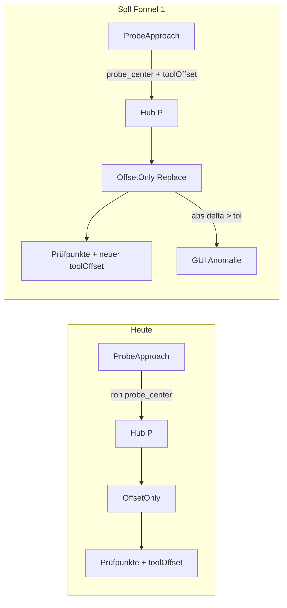

# TCP-Offset / Einmessen — Ist-Stand und Implementierungsplan

## Soll vs. Ist


| Anforderung                                      | Ist                                                                  |
| ------------------------------------------------ | -------------------------------------------------------------------- |
| Bekannter Messtasterpunkt anfahren               | Ja — `ProbeApproach` → `probe_center`                                |
| Antasten bestimmt TCP-Offset                     | Ja — OffsetOnly: `toolOffset = probeCenter − measured`               |
| Offset speichern                                 | Ja — Core-RAM + GUI `calibration.json` / `machineConfig` via Sync    |
| Ziele mit korrigiertem TCP                       | Ja für Prüfpunkte: `machine = plateOrigin + platePoint + toolOffset` |
| Offset über Prozedurende/-abbruch hinweg         | Ja — bei Abbruch/STOP bleibt alter Offset; bei Erfolg Replace        |
| Messtaster-Anfahrt mit Korrektur                 | **Nein** — heute roh `probe_center`, ohne Offset                     |
| Replace bei jedem Einmessen (nicht Kalibrierung) | Ja — Install setzt `toolOffset=0`; OffsetOnly ersetzt                |
| Delta > Toleranz → GUI-Anomalie                  | **Fehlt**                                                            |


Dein Gefühl („korrigiert nicht wirklich“) passt zum Gap bei der **Messtaster-Anfahrt**: Prüfpunkte nutzen den Offset, die nächste ProbeApproach nicht.




**Gewählte Anfahrtformel:** `target = probe_center + tool_offset` (wie `toMachinePoint` auf festen Install-Plattenkoordinaten `PP = probe_center − plateOrigin`).

---

## Bereits korrekt (keine Änderung nötig)

- `[core/ProbeCalibration.cpp](core/ProbeCalibration.cpp)`: Install vs OffsetOnly StorePolicy
- `[core/ProbeGeometry.hpp](core/ProbeGeometry.hpp)`: `computeToolOffset` = Replace
- `[core/CoordinateTransform.hpp](core/CoordinateTransform.hpp)`: Prüfpunkt-Transform
- Persistenz: Sync nach OffsetOnly in `[gui/server/procedure/protocolProcedureAdapter.js](gui/server/procedure/protocolProcedureAdapter.js)`; Push `tool_offset_*` bei Connect via `setMachineConfig`
- Kalibrierung (`CmdStartProbeCalib`): kein ProbeApproach, eigene Install-Logik

---

## Änderungen

### 1. ProbeApproach: Formel 1

Datei: `[core/ProcedureController.cpp](core/ProcedureController.cpp)` — `handleProbeApproach()`

Heute:

```cpp
const TestPoint target = calib.probe_center;
```

Soll:

```cpp
const TestPoint target{
    calib.probe_center.x + calib.tool_offset.x,
    calib.probe_center.y + calib.tool_offset.y,
    calib.probe_center.z + calib.tool_offset.z
};
```

XY-, Coarse-Z- und Kontaktüberwachung unverändert auf dieses `target`. Safe-Z-Traverse bleibt vorher.

Tests: `[tests/procedure_probe_tests.cpp](tests/procedure_probe_tests.cpp)` — Fall mit `tool_offset ≠ 0` vor Start; XY/Z-Ziel = `probe_center + tool_offset`.

Doku: `[docs/M19_ProbeCalibration.md](docs/M19_ProbeCalibration.md)` — Automatic-Pfad anpassen.

### 2. Offset-Delta-Anomalie (GUI, ohne M12-Wire-Change)

Toleranz nur in GUI/Parametermenü (nicht Core-Protokoll), Prüfung beim OffsetOnly-Sync:

- Neuer Parameter z.B. `tool_offset_change_tolerance_mm` (Default **0.5 mm**, euklidische 3D-Norm von Δ)
- In `[gui/server/config/parameterCatalog.js](gui/server/config/parameterCatalog.js)`: editierbar, Info-Text „Werkzeugwechsel-Verdacht“
- In `[gui/server/config/syncCalibrationFromController.js](gui/server/config/syncCalibrationFromController.js)` bzw. Adapter: vor dem Speichern `|new − old|` berechnen; bei Überschreitung Flag setzen (z.B. in `calibrationStore` oder Session-Status)
- GUI: Hinweis auf Prozedur-/Kalibrierseite (Anzeige, **nicht** blockierend — Prozedur läuft weiter; neuer Offset wird trotzdem übernommen)
- Install/FullCalib: kein Delta-Check (Kalibrierlogik); Flag zurücksetzen wenn sinnvoll
- Erster Offset nach Install mit `old≈(0,0,0)` und großem Δ: Anomalie **soll** greifen (Werkzeug weicht von Null-Referenz ab) — gewollt

Kein neues Core-Payload nötig (vermeidet M12-Size-Freeze).

### 3. Kleine Absicherung Persistenz (optional, wenn beim Test sichtbar)

`pushCommittedCalibration` pusht kein `toolOffset` explizit — nur indirekt über `setMachineConfig` aus `machineConfigStore`. Sync schreibt beide Stores. Beim Implementieren kurz verifizieren, dass nach OffsetOnly beide `tool_offset_*` und `calibration.toolOffset` konsistent sind; sonst Sync härten. Kein Architekturwechsel.

---

## Nicht im Scope

- Änderung der Offset-Vorzeichenformel `stored − measured`
- PreClamp-/Bohrungs-Anomalie (bereits vorhanden, anderes Thema)
- Install-/Kalibrierprotokoll umbauen
- STM32-Flash-Persistenz von Calib

---

## Verifikation

- Unit: ProbeApproach-Ziel mit Offset; Replace unverändert; GUI-Delta-Logik
- Sim: Offset setzen → Prozedur stoppen → neu starten → Anfahrt = `probe_center + offset` → neues Einmessen ersetzt Offset → bei künstlich großem Sprung GUI-Hinweis
- Docs M19 an Formel 1 anpassen

