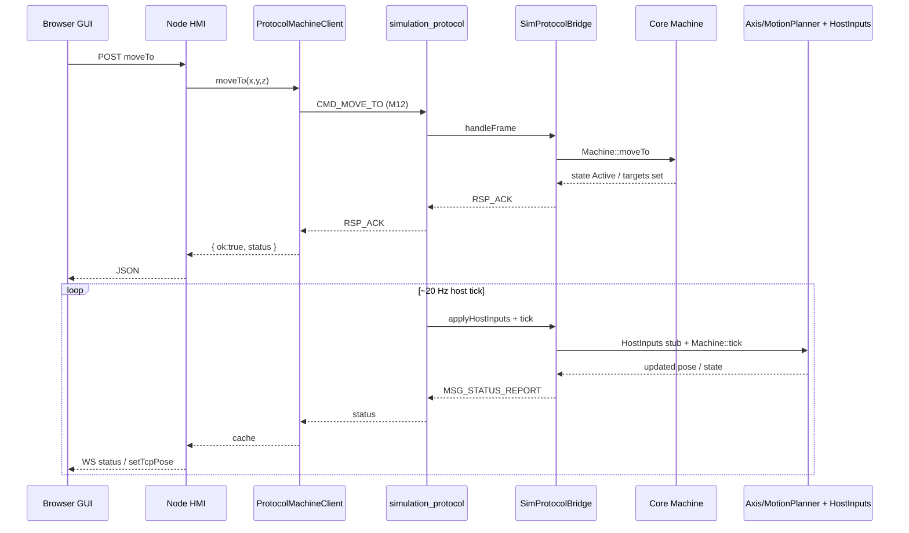
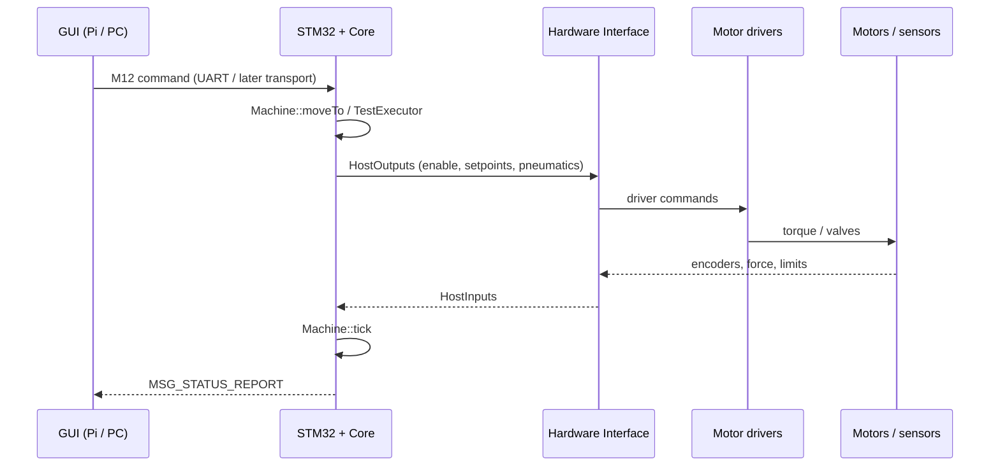

# M14.2 — Architecture Verification & Runtime Separation

This document records the **as-built** architecture after M12–M14 and the
verification goals of M14.2. It is intentionally honest about what is
controller logic versus what currently lives inside Core as simplified
kinematic integration.

## 1. Component overview

| Component | Path | Role |
|-----------|------|------|
| GUI / HMI | `gui/` | Browser + Node HTTP/WS. Commands in, status out. No Core control loop. |
| Protocol client | `gui/server/protocol/` | M12 TCP client (`ProtocolMachineClient`). Transport + mapping only. |
| Communication | `communication/` | M12 frames (encode/decode/CRC). No machine logic. |
| Bridge | `simulation_bridge/` | Maps M12 ↔ Core APIs. No motion/safety decisions of its own. |
| Protocol host | `simulation_protocol/` | TCP listen `:8766`, tick loop, I/O. Host/runtime, not a second controller. |
| Core | `core/` | **Controller**: Machine, MotionPlanner, TestExecutor, safety, force control. |
| JSON host (legacy) | `simulation_interactive/` | M8.5 newline JSON on `:8765` (pre-M14 path). |
| Real HW (future) | STM32 firmware | Same Core, real HostInputs / actuators instead of PC host. |

### Target mental model

```
GUI (HMI)
  │  Commands / Status (M12 today via TCP)
  ▼
CONTROLLER (Core)
  │  Machine / TestExecutor / MotionPlanner / Safety
  │  Hardware interface (HostInputs / HostOutputs)
  ├──────────────┬──────────────┐
  ▼              ▼              ▼
Simulation    (today)      Real HW (later)
PC host tick               STM32 + drivers
virtual sensors            motors / sensors
```

## 2. Responsibilities

### GUI = HMI only

- Accepts operator input (`moveTo`, `pause`, `resume`, `stop`, …).
- Sends commands through `MachineClient` factory.
- Receives status over WebSocket and paints UI / Three.js.
- **Must not** advance pose, compute forces, or run process state machines
  in the `MACHINE_CLIENT=protocol` path.

### Core = Controller

- Interprets motion/process commands (`Machine::moveTo`, `pause`, `resume`,
  `stop`, `TestExecutor::*`).
- Owns machine/process state.
- Runs control/safety evaluation on `tick(dt)`.
- Produces the authoritative pose/state for status reports.

### Simulation host = outer world + runtime

- `simulation_protocol` provides TCP transport and a realtime tick that calls
  into Core.
- `SimHostInputProvider` supplies **virtual** `HostInputs` (force stub, limits,
  e-stop flags).
- Does **not** reinterpret MOVE_TO / STOP; that is `CommandDispatcher` → Core.

### Communication = wire format only

- Frame header, CRC, payload codecs, message IDs.
- Bidirectional: host←client commands, host→client ACK/NACK/status.

## 3. Command data flow (MOVE_TO)

```text
Browser
  │  POST /api/command { command: "moveTo", x,y,z }
  ▼
gui/server/index.js  (handle only)
  ▼
ProtocolMachineClient.moveTo()
  │  encode CMD_MOVE_TO (M12)
  ▼  TCP 127.0.0.1:8766
simulation_protocol (recv + FrameStreamBuffer)
  ▼
SimProtocolBridge.handleFrame()
  ▼
CommandDispatcher  (map only)
  ▼
Machine::moveTo(x,y,z)     ← CONTROLLER LOGIC
  │  MotionPlanner::moveTo
  │  MachineState → Active
  ▼
RSP_ACK → ProtocolMachineClient → HTTP response
```

Periodic host loop (independent of GUI):

```text
simulation_protocol main loop (~20 Hz)
  → SimHostInputProvider.build()   ← SIMULATION / VIRTUAL SENSORS
  → Machine::setHostInputs()
  → Machine::tick(dt) / TestExecutor::tick(dt)  ← CONTROLLER TICK
  → StatusSnapshot → MSG_STATUS_REPORT → client
```

### Sequence: MOVE_TO (current PC stack)



## 4. Status data flow

```text
HostInputs (force/limits/e-stop)     ← Simulation stub today / HW later
        ▼
Core Machine / TestExecutor          ← authoritative state + pose
        ▼
StatusSnapshot / MSG_STATUS_REPORT   ← M12
        ▼
ProtocolMachineClient status cache
        ▼
Node WS /api + public/js/statusBar.js
        ▼
setTcpPose(status)                   ← visualization only
```

GUI must not invent:

- force values
- machineState / processState
- extrapolated positions between reports

Offline: last reported pose is displayed; no local integration.

## 5. Simulation data flow (what “moves”)

Honest classification for M14.2:

| Code | Classification | Notes |
|------|----------------|-------|
| `CommandDispatcher::dispatch` | Transport mapping | Calls Core; no motion math |
| `Machine::moveTo/pause/resume/stop` | **CONTROLLER LOGIC** | State + commanded targets |
| `TestExecutor::*` | **CONTROLLER LOGIC** | Process sequencing |
| `Machine::tick` safety / force phases | **CONTROLLER LOGIC** | Decisions based on HostInputs |
| `MotionPlanner` / `Axis::tick` | **Controller-owned kinematics** (simplified plant model inside Core) | Advances virtual position when Core is ticked |
| `SimHostInputProvider` | **SIMULATION PHYSICS / SENSORS** | Demo force = k·pose; limits/e-stop injectors |
| `Machine::updatePneumaticStub` | Stub I/O (Core) | Deterministic Extended=Extend until real I/O |
| `simulation_protocol` main | Host/runtime | TCP + scheduling `tick` |
| `ProtocolMachineClient` | HMI transport | No `tick()` |
| `MockMachineClient.tick` | Dev mock only | Not used in `protocol` path |

**Important finding (documented, not refactored in M14.2):**

Today there is **no separate `SimulationMotor` class**. The PC “outer world”
for axes is largely the Core’s own `Axis`/`MotionPlanner` integration, while
true outer-world stubs are mainly `HostInputs` (and pneumatic feedback stub).

That still means:

- GUI does **not** control motion.
- Commands are interpreted by **Core**.
- The host only provides I/O + time.

Long-term STM32 direction: keep Core decisions; replace virtual axis
integration / stubs with encoder feedback and real actuators via the same
`HostInputs` / `HostOutputs` boundary.

## 6. Future STM32 data flow



M14.2 does **not** implement STM32 firmware.

## 7. Hardware abstraction (current vs proposal)

**Exists today (minimal, adequate for M14.2):**

- `HostInputs` / `HostOutputs` POD boundary in Core.
- Host injects inputs (`SimHostInputProvider` on PC).
- Core emits outputs (spreader/fixture commands, etc.).

**Not required for M14.2:** a large `SimulationBackend` / `STM32Backend`
framework. Recommendation for M15+: keep expanding Host I/O adapters around
the existing POD interface rather than forking Core.

## 8. Runtime separation (dev scripts)

Independent lifecycles (M14.2):

```bash
npm run dev:start-gui
npm run dev:start-simulation
npm run dev:stop-gui
npm run dev:stop-simulation
npm run dev:start-all    # convenience
npm run dev:stop-all
```

Aliases: `dev:start` → `start-all`, `dev:stop` → `stop-all`.

Rules:

- Stopping GUI must not stop `simulation_protocol`.
- Stopping simulation must not stop GUI.
- Ownership checks from M14.1 remain (no blanket `node` kills).

## 9. Verification proofs

Automated:

```bash
cd gui
npm run proof:architecture   # A–G + negativ path
npm run proof:offline        # ProtocolMachineClient offline pose freeze
npm run test:protocol
npm run smoke:g14            # needs GUI+host on 3000/8766
```

C++ (controller path without GUI):

```bash
ctest --test-dir build --output-on-failure   # includes bridge_* TCP tests
```

## 10. Explicit answer to the central question

> When the GUI sends MOVE_TO, is Core the component that controls machine
> motion, while simulation only represents the outer world?

**Yes for command authority and HMI isolation:**

- GUI / ProtocolMachineClient only transport commands and display status.
- `CommandDispatcher` maps to `Machine::moveTo` / stop / pause / resume.
- Core decides acceptance, state transitions, and motion targets.
- Pose displayed in the GUI comes only from Core status reports.

**Nuance (must not be papered over):**

- Virtual axis position integration currently lives **inside Core**
  (`MotionPlanner`/`Axis`), not in a dedicated simulation-physics module.
- Outer-world **sensor** behavior on PC is primarily
  `SimHostInputProvider` (+ pneumatic stub).

So: the simulation host is **not** a second controller, and the GUI is **not**
the controller. Core is the controller. The PC “plant” for axes is still a
simplified model collocated with Core until a richer hardware/simulation
backend is introduced behind `HostInputs`/`HostOutputs`.
